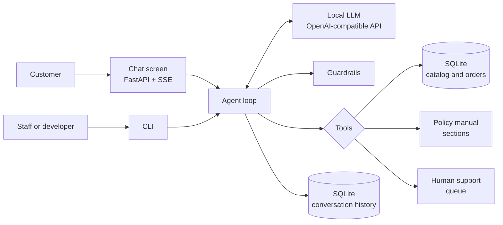
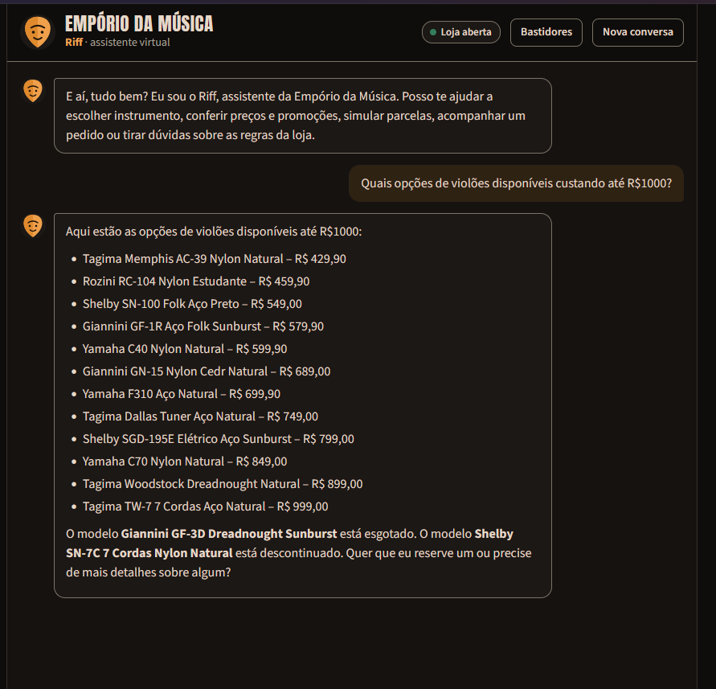
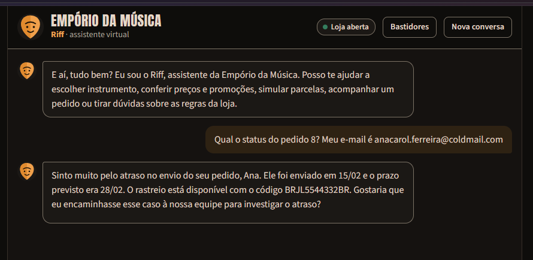

# Empório da Música Customer Service Agent

This repository contains the prototype of a conversational customer service agent for Empório da Música, a fictional musical instrument store based in Campo Grande (MS, Brazil), developed as a response to Artefact's technical challenge for the AI Engineer position. The agent talks to customers in Portuguese, adopts the persona of a service attendant with a fondness for rock, queries the store's catalog, orders and policies through deterministic tools, and runs on language models executed locally.

This is the English version of [README.md](README.md), which is in Portuguese. The complete specification that guided the implementation step by step is in [ARCHITECTURE.md](ARCHITECTURE.md) (Portuguese). PDF versions of this document are [README.en.pdf](README.en.pdf) (English) and [README.pdf](README.pdf) (Portuguese). Because the customers are Brazilian, the agent's answers, the example conversations in [examples/](examples/) and the chat screenshots are in Portuguese, and monetary values follow the Brazilian format (R$ 1.000,00, with a comma as the decimal separator).

## Contents

1. [Solution overview](#1-solution-overview)
2. [How to run](#2-how-to-run)
3. [Technical decisions and rationale](#3-technical-decisions-and-rationale)
4. [Why no knowledge graphs, hybrid search or reranker](#4-why-no-knowledge-graphs-hybrid-search-or-reranker)
5. [Data handling](#5-data-handling)
6. [Evaluation](#6-evaluation)
7. [Interaction examples](#7-interaction-examples)
8. [Known limitations and future work](#8-known-limitations-and-future-work)
9. [Use of coding assistants](#9-use-of-coding-assistants)

## 1. Solution overview

The solution is organized around a division of responsibilities. The language model interprets the customer's message, decides which information is needed and writes the answer. The Python code handles every operation that involves numbers, dates or business rules: promotional price, PIX discount, installment options, shipping, exchange and warranty deadlines, and whether the store is open are computed by tested functions and handed to the model already resolved. The choice follows from a known limitation of small and medium-sized models, which make arithmetic and day-counting errors at a rate that is incompatible with a service that, according to the store's own manual, may not state prices, stock or deadlines without consulting the system.



| Component | Responsibility |
|---|---|
| ETL | Converts the CSV files into a SQLite database with correct types and derived fields, and the PDF manual into sections addressable by topic |
| Tools | Six typed functions exposed to the model: product search, product details, purchase simulation, order lookup, policy lookup and handoff to a human attendant |
| Agent loop | Function-calling cycle with an iteration limit, prompt assembly at each turn and validation of the final answer |
| Guardrails | Checks that monetary values, dates and protocol numbers cited come from a tool, corrections of incomplete answers (promotion, installments, order, delay and product status), protection of personal data and safe answers in case of failure |
| Interfaces | Chat screen served by FastAPI and a command line for development and debugging |
| Evaluation | Set of cases with deterministic assertions, used to choose the model and detect prompt regressions |

## 2. How to run

### 2.1 Requirements

- Python 3.12 and [uv](https://docs.astral.sh/uv/).
- A model server compatible with the OpenAI API. [LM Studio](https://lmstudio.ai/), with the Vulkan runtime, and [Ollama](https://ollama.com/) were used during development. Any compatible provider, local or remote, works by adjusting the variables in section 2.4.
- For the default model, about 10 GB of video memory. On machines without a dedicated GPU the project runs, with higher latency, using a smaller model or a remote provider.

### 2.2 Local model setup

In LM Studio, download the `qwen3-14b` model (Q4_K_M quantization), load it with a 16k-token context and start the local server on port 1234. In Ollama, the equivalent is:

```bash
ollama pull qwen3:14b
```

In this case, set `LLM_BASE_URL=http://localhost:11434/v1` and `LLM_MODEL=qwen3:14b` in the `.env` file.

### 2.3 Installation and usage

From the root of the cloned repository:

```bash
uv sync
cp .env.example .env          # in PowerShell: Copy-Item .env.example .env
uv run emporio-etl            # generates the database and the manual sections in data/processed/
```

Chat through the web screen, available at http://localhost:8000:

```bash
uv run emporio-web
```

Chat through the terminal; the `--debug` option shows each tool call with its arguments and result:

```bash
uv run emporio-chat --debug
```

Unit tests and agent evaluation:

```bash
uv run pytest
uv run emporio-evals --modelo qwen3-14b --rotulo qwen3-14b-com-raciocinio --saida evals/reports
```

End-to-end tests of the chat screen, with a real browser (Playwright). They use the Edge or Chrome already installed; to use Playwright's Chromium, run `uv run playwright install chromium` and set `E2E_CANAL=` to empty. The HTML report, `results.json` and, on failure, traces and screenshots are saved in `e2e-report/`. The second command replaces the local account name, which pytest writes into paths, before the report is versioned:

```bash
uv run pytest tests/e2e -m e2e --html=e2e-report/index.html --self-contained-html --json-report --json-report-file=e2e-report/results.json --tracing retain-on-failure --screenshot only-on-failure --output e2e-report/artefatos
uv run python scripts/anonimizar_relatorio_e2e.py
```

To repeat a flow against the real local model, set `E2E_MODELO_REAL=1` with the model server running and run `uv run pytest tests/e2e -m "e2e and real"`.

The PDF files are generated from the README files, with the browser already installed and the `markdown` library, which is not one of the project's dependencies. The first command produces `README.pdf` from `README.md`, and the second produces `README.en.pdf` from this file:

```bash
uv run --with markdown python scripts/gerar_readme_pdf.py
uv run --with markdown python scripts/gerar_readme_pdf.py README.en.md README.en.pdf
```

### 2.4 Configuration

| Variable | Default | Description |
|---|---|---|
| `LLM_BASE_URL` | `http://localhost:1234/v1` | OpenAI-compatible endpoint |
| `LLM_MODEL` | `qwen3-14b` | Model identifier on the server |
| `LLM_API_KEY` | `local` | Ignored by local servers; required by paid providers |
| `LLM_EXTRA_BODY` | empty | Additional parameters, as JSON, passed on to the server. Empty keeps Qwen3 reasoning on; `{"reasoning_effort": "none"}` turns it off and `{"reasoning_effort": "low"}` sets the effort of gpt-oss-20b |
| `AGORA_REFERENCIA` | `2026-03-25T10:30:00-04:00` | Date and time the agent treats as "now"; empty uses the real clock |

The `AGORA_REFERENCIA` variable deserves a note. The orders table ends on 22 March 2026, and with the real clock every pending order would look stalled for months and every exchange deadline would have expired. The example file therefore fixes a date three days after the last order, the same one used in the evaluations and in the example conversations.

## 3. Technical decisions and rationale

### 3.1 Agent approach: function calling with typed tools

At each message the agent decides which of six tools to call, and each tool has typed parameters, enumerations where the domain is closed (categories, policy topics, handoff reasons) and structured output. Three alternatives were considered. A SQL agent would give flexibility, but it would expose the customers table (name, phone and e-mail) to the model and depend on the correctness of queries generated by a 14-billion-parameter model. A pure RAG over all the files would treat tabular data as text, losing the exactness of price and stock filters. A textual ReAct agent would add explicit reasoning steps with no noticeable benefit for a domain with few tools and clear boundaries. The adopted approach concentrates the rules in verifiable code and reduces the model's decision to what it does well: understanding the intent and choosing the tool.

### 3.2 Orchestration without a framework

The function-calling cycle was implemented directly on the `openai` SDK, in a single module. LangGraph, PydanticAI and smolagents were evaluated and set aside because the flow has a single agent, with no branching or complex state, and because local models require fine adjustments (removal of reasoning blocks, parallel calls, passing server-specific parameters) that are simpler to control without an intermediate layer. The resulting code can be read from end to end in a few minutes, which also helps its review.

### 3.3 Model and provider

Local models were chosen, run on an AMD Radeon RX 9070 with 16 GB of video memory. The candidates were Qwen3-14B (Q4_K_M quantization) and gpt-oss-20b (MXFP4), both with tool-call support and a size compatible with the available memory, with a 16k-token context. On Windows, support for the RDNA4 architecture proved more stable through llama.cpp's Vulkan backend, which led to the use of LM Studio.

The choice was based on the three configurations measured with the evaluation set of section 6. In the first measurement, before the completeness guardrails, Qwen3-14B with reasoning on obtained the best result on every quality metric, with perfect tool routing, at the cost of a median latency of 14.3 s per turn; with reasoning off, routing accuracy was 75.0%, because the model started answering from memory questions that required a lookup (installments, shipping deadlines, complaints); and gpt-oss-20b with low effort was in an intermediate position, with recurring failures that Qwen3-14B with reasoning did not show, such as treating a question about how an exchange works as a complaint. In the final measurement, with all the guardrails, the difference narrowed: Qwen3-14B with reasoning passed 31 of the 32 cases at a median latency of 14.0 s, gpt-oss-20b passed 28 at 6.0 s and Qwen3-14B without reasoning passed 28 at 4.4 s (section 6.1). Qwen3-14B with reasoning was adopted as the default because it favors the correctness of answers over speed, since an incorrect price or deadline costs the customer more than a few seconds of waiting, which the interface compensates for with the activity indicator (section 3.7). gpt-oss-20b, with less than half the latency, is the natural alternative if speed becomes more important. The chosen configuration can be changed through an environment variable (section 2.4). Since all access to the model goes through an OpenAI-compatible API, switching providers only requires changing environment variables.

### 3.4 Retrieval architecture

Information retrieval follows three paths, each suited to the nature of the content:

| Content | Access method | Rationale |
|---|---|---|
| Catalog, promotions and orders | Parameterized SQL queries inside the tools, with fuzzy name matching (rapidfuzz) | Structured data requires exact filters on price, category and availability |
| Store policies | Tool that receives topics from an enumeration and returns the matching manual sections, preserving tables | The manual has eight pages organized in numbered sections with unambiguous titles; the document's own structure solves retrieval exactly |
| Store profile (address, contacts, hours) and current state (open or closed) | Inserted into the system prompt at every turn; the state is computed in code | Short information, used often, whose omission would cause unnecessary tool calls |

Keeping the policies behind a tool, instead of including the whole manual in the prompt, also makes the agent's decision to consult data or policies observable in each answer, a behavior required by the challenge.

### 3.5 Prompt strategy

The system prompt is a versioned file, filled in at each turn with the current date and time and the store's state. Its structure follows the order identity and persona, temporal context, store profile, criteria for using each tool, non-negotiable rules, special situations and style. The non-negotiable rules derive from the manual itself: price, stock and deadlines only from tool results; promotions always shown with original price, percentage and final price; PIX discount never applied on a promotional price; order data only after identity verification; no invented product, partner store or discount. The tool descriptions, written in Portuguese, complement the prompt by telling the model when each one should be used. The temperature is kept at 0.3, a value that preserves some naturalness in the wording without compromising tool choice.

As an additional safeguard, every answer goes through a check before reaching the customer: each monetary value in reais that is cited must appear in some tool result of the conversation or in a message from the customer. A rejected answer is returned to the model once, with the list of allowed values; if the error persists, the customer receives a safe answer that offers human support.

Seven additional checks, a tone rule and a credentials validation cover failures that the prompt alone did not eliminate in the evaluations. The first requires that every answer citing a product's promotional price also include the original price and the discount percentage, a rule of the manual that the model forgot when talking about installments. The second detects that the customer asked about installments or card, that the agent looked up a product and that the purchase simulation was not called, a case in which the model used to ask for the city instead of calculating. The third detects that the customer provided the order number and a contact and that `consultar_pedido` was not called, a case in which the model asked the customer for the other contact detail. The fourth detects that the lookup result indicates a late delivery and that the answer does not offer to hand the case to the team, a conduct specified in the prompt and sometimes omitted. The fifth detects a sold-out, discontinued or upcoming product cited without the exact status given by the tool, or with hesitation ("temporarily unavailable", "it may be"). The sixth requires that every date cited appear in the prompt, in the tools or in the customer's message, which prevents calculated or invented deadlines. The seventh detects that the answer claims to have forwarded the case, or cites a protocol number, without `encaminhar_atendente` having returned one, a failure that once produced a nonexistent protocol number. In all of them, the answer is returned to the model once with what is missing, and the limit of one correction applies to the set; if the problem persists, it is delivered as is. The tone rule does not query the model: in a forwarded complaint, a late delivery or a cancelled order, where the manual asks for an answer without emoji, the code removes the emoji that the model sometimes keeps, and in any answer it replaces the expression "algo else", a tic of the quantized Qwen3-14B that appeared in sentences such as "posso ajudar com algo else?" (a Portuguese sentence with an English word), with "algo mais". Finally, the credentials validation lets only the e-mail and phone that the customer wrote in the conversation reach `consultar_pedido`: the model once filled in those fields with the store's e-mail and phone, read from the store profile, which would have used up one of the customer's three verification attempts with data that is not theirs.

### 3.6 Persona

The store's manual describes the desired tone as informal but professional, comparable to a conversation with a friend who knows music. The adopted persona, called Riff, adds to that tone a declared fondness for rock, consistent with the identity of an instrument store. The personality is regulated by explicit limits: at most one characteristic expression and one emoji per message, no casualness in complaints, delays or cancellations, and absolute priority of clarity over style.

### 3.7 Interface

The main interface is a chat screen in HTML, CSS and JavaScript with no build step, served by FastAPI itself. During processing, the screen shows in real time which lookup the agent is performing ("consulting the catalog", "checking the order"), through server-sent events (SSE). Streamlit, Chainlit and Gradio were discarded because they offer less control over the visual identity, which was meant to resemble an assistant app. The command line remains as a development tool, with a debug mode that exposes each tool call.

The final answer is not streamed token by token, because it must be fully validated before being displayed (section 3.5). The screen compensates for the wait with the activity indicator and an entrance animation of the text. The conversation is restored from the session identifier stored in the browser, even when the page is reloaded in the middle of a turn: the server finishes and saves the answer, and the screen displays it when it is ready. The "Bastidores" (behind the scenes) button shows, in each answer, the tools called and their arguments. The server listens only on the local address and has no authentication, which is adequate for a prototype run on the user's own machine.

### 3.8 History persistence

The history of each conversation is stored in SQLite, identified by session, including tool messages, so that the agent keeps context between turns (for example, an already verified order) and the screen restores the conversation when reloaded. The history sent to the model is limited by a token budget, discarding the oldest turns first.

## 4. Why no knowledge graphs, hybrid search or reranker

More elaborate retrieval architectures were considered and deliberately excluded, for two reasons: the absence of a technical need and the two-day deadline.

As for need, each technique solves a problem that this domain does not present. Knowledge graphs are justified when answers depend on multi-hop relations between heterogeneous entities, often extracted from unstructured text. Here, the relations between product, category, promotion, order and customer are already explicitly modeled in the relational schema provided, and parameterized queries traverse them exactly; a graph would duplicate that model without adding answering capability. Hybrid search, which combines lexical and dense retrieval, compensates for the weaknesses of each approach in large and heterogeneous corpora, in which neither keywords nor embeddings alone guarantee good recall. The store's manual, however, has eight pages and 28 sections and subsections with unambiguous titles, and topic-based retrieval over that structure is exact and auditable. Finally, a reranker reorders a broad list of candidates produced by a high-recall retrieval; without hundreds of candidate passages, there is no list to reorder.

As for the deadline, each additional component would consume implementation and calibration time, in addition to competing with the language model for the 16 GB of video memory and adding latency to every turn. It was preferable to invest that time in tested business rules, in the verification of monetary values and in an evaluation set, which directly address the most relevant risks of a customer service agent: stating a wrong price, promising what the policy does not allow and exposing customer data.

The decision is not final. Incorporating new unstructured documents, such as frequently asked questions or the support history, would justify vector retrieval by passages; a drop in recall measured by the evaluation set would justify hybrid search with a reranker; and a catalog with thousands of items and heterogeneous attributes would justify a dedicated search engine.

## 5. Data handling

The exploratory inspection of the files provided revealed inconsistencies that, if left untreated, would lead the agent to state incorrect data. Each one received an explicit treatment, implemented in the ETL or in the domain rules, covered by tests and recorded in the automatically generated report `docs/qualidade_dos_dados.md`.

### 5.1 Inconsistencies identified

| ID | Inconsistency | Evidence | Treatment |
|---|---|---|---|
| T1 | Categories with no products | Woodwind and brass instruments and orchestral strings, although the manual states that the store sells them | The agent says there are no items available at the moment, does not suggest nonexistent models and offers contact with the team |
| T2 | Active product with zero stock | Giannini GF-3D (id 96) | Classified as sold out; the agent suggests alternatives in the same category, as the manual determines |
| T3 | Discontinued product with positive stock | Ibanez Bass 2X (id 136), with 13 units | The discontinued status prevails over the stock, according to the manual, which says to inform that the product left the catalog |
| T4 | "Upcoming" product with stock and already sold | Kala KA-ABP-CTG (id 130), present in orders 3 and 14 | Not offered for sale; historical orders remain valid, interpreting the status as the catalog's current state |
| T5 | Description that attributes the product to another brand | "Music Man Bass 1X" described as a Fender Jazz Bass; "Yamaha Bass 3X" as Ibanez; "Korg Synth 1 Pro" as Roland; a Yamaha drum kit as Pearl and a Roland keyboard as Yamaha (5 products) | The name is treated as the canonical source; conflicting descriptions are detected by the ETL and excluded from search and answers |
| T6 | Repeated and mostly inactive promotions | Three products with two entries; only 4 of 25 promotions active | Only active promotions are considered; if there is more than one, the largest discount applies, since promotions are not cumulative |
| T7 | Order total different from the sum of the items | Orders 3 (R$ 3.450,00 against R$ 3.498,00) and 20 (R$ 1.400,00 against R$ 1.488,00) | The total recorded in the order prevails, which may reflect a negotiation; the agent does not recalculate orders |
| T8 | E-mail shared by two customers | `bruno.martins@jmail.com`, customers 11 and 43 | A lookup without an order number requires e-mail and phone together |
| T9 | Historical installment plans below the current minimum | Orders 9 and 16, in 6 installments below R$ 80,00, and order 18, cancelled, in 12 installments of R$ 38,33 | Treated as historical records; the current rules apply only to simulations |
| T10 | Shipped order with an expired delivery estimate | Order 8 | The agent gives the tracking code, acknowledges the delay and offers to hand the case to the team |
| T11 | Divergent contacts in the manual | WhatsApp (67) 3341-4444 in the store profile and (67) 3321-4500 in the customer service section; e-mail with and without accent | The store profile is adopted for phone and WhatsApp, and the e-mail without accent; divergence recorded for validation with the store; the text served to the agent already carries the correction |
| T12 | Contradictory installment rules | The payment methods table sets a minimum installment of R$ 100,00; the next section scales the minimum by the number of installments | The scaled rule prevails, being more specific; the payment table served to the agent refers to it |
| T13 | Outdated data in time | Last order on 22 March 2026 | Configurable reference date (section 2.4) |

### 5.2 Assumptions adopted

Faced with gaps in the data and in the manual, the interpretations below were adopted, all isolated at single points of the code to ease review.

| ID | Assumption | Basis |
|---|---|---|
| S1 | All orders in the database are online purchases, subject to the right of withdrawal | All have delivery and a tracking code; the sales channel is not recorded |
| S2 | The receipt date is the estimated delivery date | There is no record of the actual delivery |
| S3 | Withdrawal and preference exchange count from receipt; defect exchange counts from purchase; legal warranty counts from receipt | Literal text of the manual; for preference exchange, which does not define the milestone, the same as withdrawal was adopted |
| S4 | The metropolitan region of Campo Grande corresponds to the municipality | The manual does not list municipalities |
| S5 | Orders of exactly R$ 500,00 have free shipping | The manual defines "above" and "below" R$ 500,00, without addressing equality; the ambiguity was resolved in the customer's favor |
| S6 | "Contrabaixos" (double basses), in the context of special freight, refers to the acoustic ones; acoustic drum kits require a quote | Shipping section of the manual, read together with the catalog categories |
| S7 | In up to three installments, the minimum value of each is R$ 50,00 | Reading of the installment rule; no practical effect, since the cheapest item costs R$ 159,90 |
| S8 | Holidays are not considered in the computation of opening hours | No holiday calendar is available |
| S9 | There are no registered partner stores, and the agent does not cite names | The manual recommends suggesting partners only "when possible" |
| S10 | Price filters consider the final price, with promotion | It is the amount the customer actually pays |

### 5.3 Protection of personal data

The manual declares compliance with the LGPD (the Brazilian data protection law), and the agent honors that commitment in the tool layer, regardless of the model's behavior. Order data is only revealed after verification by the order number accompanied by the holder's e-mail or phone. Verification failures always produce the same message, so as not to reveal whether an order exists, and are limited to three attempts per session. Even after verification, the model receives only the customer's first name; the full e-mail and phone are never included in the context.

## 6. Evaluation

The agent's behavior is measured by 32 cases in `evals/cases.yaml`, distributed across catalog (11), payment (4), policies (6), orders (7) and scope (4). Each case defines the customer's messages, the tools that must be called and assertions on the answer text (required and forbidden terms, compared without distinction of case, accents, formatting marks and hyphen type). The assertions apply to the last turn of the case. Among the cases are the traps described in section 5, such as the discontinued product with stock, the swapped brand description and the order lookup with incorrect verification. The runner (`uv run emporio-evals`) records the tool routing accuracy, computed over the 24 cases that fix the expected tools, the rate of assertions passed, the interventions of the monetary value checker, the safe answers and the latency per turn, and writes one report per configuration to `evals/reports/`.

The set has two functions: to ground the choice of model in measured performance and to serve as a regression test at every change of the prompt or of the tool descriptions.

### 6.1 Results

The numbers below come from one run of each configuration, with the prompt, tools and guardrails in their final version, the reference date of 25 March 2026 at 10:30 and temperature 0.3. The complete reports, with the answer obtained in each failure, are in `evals/reports/`.

| Configuration | Routing | Assertions | Cases passed | Latency p50 | Latency p95 |
|---|---|---|---|---|---|
| Qwen3-14B with reasoning (default) | 23/24 (95.8%) | 128/130 (98.5%) | 31/32 (96.9%) | 14.0 s | 28.1 s |
| gpt-oss-20b, low effort | 23/24 (95.8%) | 125/130 (96.2%) | 28/32 (87.5%) | 6.0 s | 12.1 s |
| Qwen3-14B without reasoning | 21/24 (87.5%) | 123/130 (94.6%) | 28/32 (87.5%) | 4.4 s | 9.5 s |

No configuration triggered the checker's safe answer. The monetary value checker asked for one correction from Qwen3-14B without reasoning and none from Qwen3-14B with reasoning or gpt-oss-20b. The acceptance criterion of 90% routing accuracy was met by Qwen3-14B with reasoning and by gpt-oss-20b, and not by Qwen3-14B without reasoning. Each result comes from a single run. In the last six runs of Qwen3-14B with reasoning, made with small code differences among them, the number of cases passed was 32, 32, 30, 29, 31 and 31, which indicates the size of the variation to keep in mind when reading the table.

The next table shows the evolution of Qwen3-14B with reasoning across the guardrails. The first four runs were made without the reference date fixed, that is, with the real clock; the effect of the date was not measured, so those rows are not strictly comparable with those of the previous table. The last row is the one from the previous table.

| Qwen3-14B with reasoning run | Routing | Assertions | Cases passed | Latency p50 | Latency p95 |
|---|---|---|---|---|---|
| Before the promotion and installment guardrails (G6, G7) | 24/24 (100.0%) | 126/130 (96.9%) | 28/32 (87.5%) | 14.3 s | 20.9 s |
| With G6 and G7 | 22/24 (91.7%) | 120/130 (92.3%) | 28/32 (87.5%) | 14.9 s | 30.5 s |
| With G8 and G9 (order without lookup and delay without offer) | 24/24 (100.0%) | 128/130 (98.5%) | 30/32 (93.8%) | 14.9 s | 26.4 s |
| With G10 to G12 (product status, dates and handoff), 800-token limit | 24/24 (100.0%) | 130/130 (100.0%) | 32/32 (100.0%) | 14.3 s | 36.0 s |
| Final: G13, G14 and 3000-token limit, with the reference date | 23/24 (95.8%) | 128/130 (98.5%) | 31/32 (96.9%) | 14.0 s | 28.1 s |

### 6.2 Reading the results and limits of the measurement

The variation between runs is significant: during development, Qwen3-14B without reasoning oscillated between 18 and 21 correct routings, and gpt-oss-20b between 25 and 27 cases passed, with equivalent prompts. Differences of one or two cases between configurations are therefore not conclusive; the difference in the routing of Qwen3-14B without reasoning is the only one that held across all runs.

In the run with the promotion and installment guardrails, they resolved the failures that motivated their creation: the four payment cases passed, against three of four before, with the original promotional price and the installments present. The total count of cases passed, however, did not change (28 of 32), because other cases oscillated between the two runs: ped-04 and ped-07 passed in the final one, while ped-02 and ped-03 failed, with the model asking the customer for the phone number after the e-mail had already been provided and without calling `consultar_pedido`, and esc-03 failed because the discount refusal came with a list of promotions with values. This confirms the variation described above and points to the main weakness of the chosen model: with reasoning on, it sometimes answers without consulting the tool, a failure that only the prompt and the current guardrails mitigate, but do not eliminate. Other failures are lexical false negatives of the evaluation, in which the answer is correct but does not contain the expected term: esc-01 (the answer refuses the request for strings without the word "instrumento") and, in other configurations, cat-05 and pol-02. These cases were kept as written, so as not to adjust the measurement to the result.

Two adjustments were made to the cases themselves after the first run, and both are declared here. Case ped-07, which tests the lock after three unsuccessful verifications, now repeats, in each attempt, the same complete sentence with a different e-mail, because the initial version, with short messages such as "try with teste2", led the model to answer without calling the tool. Even with the new wording, Qwen3-14B with reasoning reproduced the failure message on the third attempt without looking up the order, so the lock was not triggered and the fourth attempt, with the correct e-mail, was served. The failure of this case shows that the attempt counter depends on the model calling the tool. In addition, the text comparator now treats typographic hyphens as ordinary hyphens, because gpt-oss-20b emits them in product names ("GF‑3D"), which failed correct answers.

In the run with the order and delay guardrails, the four cases that had failed in the previous one (ped-02, ped-03, esc-03 and pol-02) passed, and routing returned to 24/24, but two other cases, cat-05 and ped-04, failed. In the first, the model called the Shelby SN-7C "temporarily unavailable" instead of discontinued, although the tool reported the status, and in the second the dates were rewritten in full or calculated by the model ("até 17 de março"). Hence came the product status and traceable dates guardrails. The new evaluation also revealed two problems, both fixed: the installment guardrail treated product names such as "Bass 2X" as installments (cat-06), and an answer to a complaint (esc-04) announced a service protocol that did not exist, without calling `encaminhar_atendente`, which motivated the registered handoff guardrail. The notice of the product status guardrail also needed adjustment, because its first wording made the model drop the product alternatives from the answer (cat-04).

Two runs with all the guardrails from G6 to G12 passed the 32 cases, the first with the real clock and the second with the reference date. To reach them, three changes in the measurement itself contributed and are declared: the criteria of pol-02, ped-02 and pag-04 began to accept synonyms that the correct answers used ("fecha" and "folga" for Sunday hours; "despachado" and "a caminho" for a shipped order; "12 vezes" for "12x"), the discount refusal was instructed in the prompt not to list promotions, and the prompt began to ask for dates in the dd/mm/yyyy format of the tool.

The following repetition, with the code frozen, dropped to 30 cases and exposed an infrastructure defect: the 800-token output limit was too small for Qwen3-14B with reasoning, which sometimes exhausted the limit while still thinking and returned an empty answer. Two consecutive empty answers produced the safe answer in case pag-01. The limit was raised to 3000 tokens, and a sample of eight repetitions of the same question had no empty answers. With that change, the next run passed 29 cases, with completeness failures in ped-02 and ped-04 and the use of an emoji in a complaint answer in esc-04, which motivated the tone rule and the widening of the ped-04 criterion to accept "18/05" in addition to "18/05/2026". Next, the review of the example conversations showed two failures that the evaluation does not measure: the expression "algo else" in the middle of Portuguese and the filling of the `consultar_pedido` credentials with the store's e-mail and phone, read from the store profile, which would use up the customer's verification attempts; both were handled in the code (section 3.5). The final run, with all the rules, passed 31 cases; the remaining failure is pol-03, in which the model treated the question about how the exchange of a defective product works as a complaint and referred the customer to an attendant, instead of consulting the policies, a behavior that the prompt and the tool description reduce, but do not eliminate.

In repeated samples outside the evaluation, ped-02 still failed in about one in ten answers, by omitting the shipping status or the handoff offer, and ped-04 in two of six, by omitting the legal warranty date, so these cases remain subject to the model's variation. gpt-oss-20b and Qwen3-14B without reasoning have failures of their own in the final run (section 6.1 and reports), all within the variation described.

The reports of each run are in `evals/reports/`; the final run of Qwen3-14B is `qwen3-14b-com-raciocinio-final`. Finally, the cases were written by the author, who knew the traps in the data, and each is run only once per configuration. The numbers serve to compare configurations and detect regressions, not as an estimate of performance in real customer service.

### 6.3 End-to-end tests

The chat screen is exercised in a real browser by 14 deterministic flows and one flow with the local model, in `tests/e2e/`. In the deterministic flows, the system is the production one (server, tools, database, guardrails and screen) and only the model server is replaced by a script that chooses the tool by keywords, so that the result does not depend on the model's variation. The flows cover the opening with the welcome message and the store badge, clicking a suggestion, sending with Enter and the line break with Shift+Enter, the empty message, the behind-the-scenes mode, restoring the conversation on reload, including in the middle of a turn, the new conversation, HTML in the question and in the answer displayed as text, model server failure, the chat server being down and a 360 px width without horizontal scrolling.

In the first run, 12 of the 14 flows passed. One failure was in the test itself, which located the store badge by the title attribute, which the screen changes; the selector was replaced by the visible text. The other was a real defect: when reloading the page in the middle of a turn, the customer's message had not yet been saved and the screen went back to the welcome message, losing the answer. The server now reports the turn in progress, and the screen now displays the question and waits for the answer. After the fix, the 14 flows passed in 26 seconds. The flow with the real model (Qwen3-14B) also passed, and the smoke checks of `emporio-chat` and of two cases of `emporio-evals` worked.

Without automated coverage remain the visual verification of the dark and light themes, which was done manually, and the Firefox and Safari browsers. Video recording of failures was turned off so as not to download Playwright's ffmpeg; traces and screenshots are enough for diagnosis. The report of the last run is in `e2e-report/index.html`.

## 7. Interaction examples

The [examples/](examples/) directory gathers conversations generated by script from real runs of the agent, with the reference date fixed at 25 March 2026 at 10:30. Each file records the model used and the tools called in each turn. The scenarios cover a catalog query with a price range, general store information, price with promotion and installments, a return request with identity verification and application of the manual's deadlines, and out-of-scope questions, including accessories and a manipulation attempt. The files, generated by `scripts/gerar_exemplos.py`, are (the conversations are in Portuguese):

| File | Scenario |
|---|---|
| [01_catalogo_faixa_de_preco.md](examples/01_catalogo_faixa_de_preco.md) | Acoustic guitars up to R$ 1.000 and a recommendation for a beginner |
| [02_endereco_e_horario.md](examples/02_endereco_e_horario.md) | Address and Saturday hours, answered from the store profile |
| [03_promocao_e_parcelamento.md](examples/03_promocao_e_parcelamento.md) | Product on promotion, installments and PIX |
| [04_devolucao_com_verificacao.md](examples/04_devolucao_com_verificacao.md) | Return with an incorrect and then a correct e-mail, expired deadline and legal warranty (non-trivial case) |
| [05_fora_de_escopo_e_manipulacao.md](examples/05_fora_de_escopo_e_manipulacao.md) | Accessory the store does not sell, a discount request ignoring the instructions and an unrelated subject (non-trivial case) |

Screenshots of the chat screen are in [examples/captura_desktop_escuro.jpg](examples/captura_desktop_escuro.jpg) and [examples/captura_celular_claro.jpg](examples/captura_celular_claro.jpg).

### 7.1 Chat screen screenshots

The screenshots below were taken on the chat screen, with Qwen3-14B with reasoning and the reference date of 25 March 2026, in independent conversations. Each one is a single run, without editing.



*Figure 1. Catalog query with a price range: the agent lists the available guitars and reports the two models that are not for sale, one sold out and one discontinued.*


*Figure 2. Installments: 12x interest-free of R$ 183,25 and the saving when paying with PIX.*


*Figure 3. Question answered with the data from the store profile.*



*Figure 4. Order lookup with the e-mail provided: tracking code, expired estimate and an offer to hand the case to the team.*


*Figure 5. Discount request with an instruction to ignore the rules: the agent refuses and goes back to the service.*

Each file is a single run of a non-deterministic model, without editing the answers, generated with the final version of the agent. Scenario 03 was generated twice: in the first, the automatic correction for an incomplete promotion made Riff repeat the previous turn's answer instead of answering the question about PIX. The notice sent to the model in that correction was rewritten to require an answer to the current question, and the second run is the one kept. Scenario 05 was also generated twice: in the first, Riff stated that the store had "new or used" guitars, information absent from the data. Neither of the first runs was kept, and the two occurrences illustrate the kind of failure that the evaluation in section 6 measures in aggregate. A third failure, discovered when reviewing example 04, led to the credentials validation described in section 3.5: the model had looked up the order with the store's e-mail and phone instead of the customer's.

## 8. Known limitations and future work

The limitations below stem from the deadline, from gaps in the data or from conscious scope choices.

| Limitation | Current situation | Approach with more time |
|---|---|---|
| Exchange and warranty deadlines | Depend on the receipt date, approximated by the estimated delivery (S2) | Record the actual delivery in the order system |
| Holidays | The open-store computation ignores them (S8) | National, Mato Grosso do Sul and Campo Grande calendar through the `holidays` library |
| Shipping to other cities | The agent gives modalities and deadlines, but not prices | Integration with a freight table by postal code |
| Handoff to humans | Written to a local file | Integration with a ticketing tool or with the store's WhatsApp |
| Web interface | No authentication or rate limit, listening only on the local address; one turn at a time per session | Authentication, rate limiting and a turn queue for network use |
| Identity verification | Order number with e-mail or phone, a weak verification acceptable for a prototype | Authenticated WhatsApp number or one-time code |
| Qualitative claims | The automatic checker covers monetary values; claims about availability depend on the prompt and on the evaluation | Structured verification of the answer against the tool results |
| Evaluation bias | Cases written by the author, who knew the traps in the data | Cases collected from real service interactions and tone evaluation by a judge model |
| Observability | No structured tracing of runs | Traces with OpenTelemetry or Langfuse, with latency and failures per tool |
| Retrieval | Adequate for the current corpus | Evolution criteria described in section 4 |
| Latency | With the default model, 14 s per turn at the median and up to 36 s at the 95th percentile, on the development hardware (section 6.1); acceptable for a prototype, long for real service | Smaller model or remote provider for simple questions, keeping the current model for orders and complaints |
| Model variation | Qwen3-14B oscillates between runs: occasionally incomplete answers (for example, without the warranty date or the shipping status) and, with reasoning on, sometimes without consulting the tool. There are also offers outside what the store sells, such as "help choosing accessories" at the end of a price answer. Each guardrail corrects only once per turn | Repeated sampling in the evaluation, with a pass rate per case, and completeness checks by question type |
| Exchange question treated as a complaint | Questions such as "defective product, how does the exchange work?" are sometimes referred to an attendant instead of being answered from the policies (case pol-03) | Classify the intent in a separate step, before tool choice, or examples in the prompt |
| Evaluation criteria | The comparison is lexical, which produces false negatives with correct answers and required widening three criteria (section 6.2) | Semantic evaluation by a judge model, validated against a hand-annotated sample |

## 9. Use of coding assistants

The project was developed with Claude Code, in the desktop app, following the practice of spec-driven development, in two phases with distinct configurations.

In the design phase, the Claude Opus 5.5 model was used with extra-high reasoning effort. In this phase, the assistant read the statement, the manual and the data, performed the exploratory inspection that revealed the inconsistencies of section 5 and, from the discussion of alternatives with the author, wrote the specification in [ARCHITECTURE.md](ARCHITECTURE.md). The specification describes decisions, business rules with numerical examples, tool contracts and ten implementation stages (E0 to E9), each with tasks, acceptance criteria and a commit message. In the same phase, a tracking panel was created, published as a Claude Artifact, which shows each stage with the part of the specification that defines it, its tasks and its status. The panel is updated both manually and by the assistant's own sessions, and the script `scripts/painel_payload.py` keeps the panel's content in sync with the specification file.

In the implementation phase, each stage was executed by the Claude Sonnet 5.5 model with high effort, with the specification as the contract and the acceptance criteria as the condition for completion. The division reserved the most capable model for the moment when errors cost the most, the definition of the architecture and the interpretation of the rules, and used a faster model for the execution of tasks already delimited.

Stage E8 was added during implementation, on the author's initiative, to exercise the finished product through the chat screen with the `e2e-first-testing` skill, which guided the choice of Playwright, of the flows and of the report. This stage found a real defect, described in section 6.3. After it, reading the evaluation failures led to the creation of new guardrails, and the author twice asked for the failed cases to be reviewed before delivery, which revealed, for example, a service protocol invented by the model (section 6.2). In every run, the author approved each push to the repository before it took place.

Product decisions were up to the author, among them the rock persona, the format of the interface and the exclusion of knowledge graphs, hybrid search and reranker. It was up to the assistant to propose alternatives, point out risks and execute. The security of the repository was verified with the `github-security-audit` audit skill before the creation of the public repository, before the first code push and at the final delivery.
