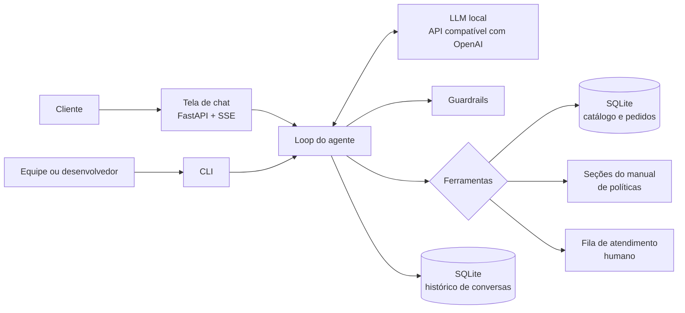
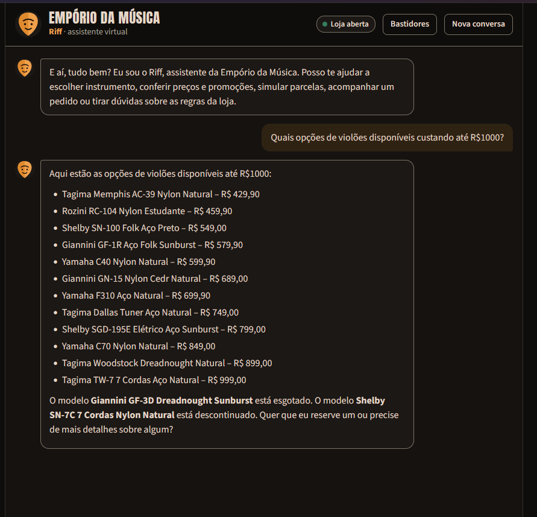
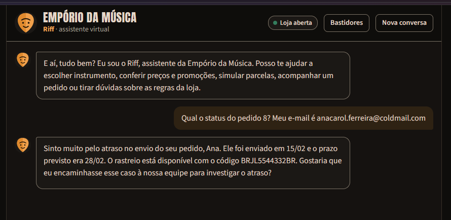

# Agente de atendimento da Empório da Música

Este repositório contém o protótipo de um agente conversacional de atendimento ao cliente para a Empório da Música, loja fictícia de instrumentos musicais sediada em Campo Grande (MS), desenvolvido como resposta ao desafio técnico para a posição de AI Engineer da Artefact. O agente conversa em português, adota a persona de um atendente com afinidade pelo rock, consulta catálogo, pedidos e políticas da loja por meio de ferramentas determinísticas e opera com modelos de linguagem executados localmente.

A especificação completa, que orientou a implementação etapa por etapa, encontra-se em [ARCHITECTURE.md](ARCHITECTURE.md). Uma versão deste documento em PDF está em [README.pdf](README.pdf).

## Sumário

1. [Visão geral da solução](#1-visão-geral-da-solução)
2. [Como executar](#2-como-executar)
3. [Decisões técnicas e justificativas](#3-decisões-técnicas-e-justificativas)
4. [Por que não grafos de conhecimento, busca híbrida e reranker](#4-por-que-não-grafos-de-conhecimento-busca-híbrida-e-reranker)
5. [Tratamento dos dados](#5-tratamento-dos-dados)
6. [Avaliação](#6-avaliação)
7. [Exemplos de interação](#7-exemplos-de-interação)
8. [Limitações conhecidas e trabalhos futuros](#8-limitações-conhecidas-e-trabalhos-futuros)
9. [Uso de assistentes de código](#9-uso-de-assistentes-de-código)

## 1. Visão geral da solução

A solução organiza-se em torno de uma divisão de responsabilidades. Ao modelo de linguagem cabe interpretar a mensagem do cliente, decidir quais informações são necessárias e redigir a resposta. Ao código Python cabe toda operação que envolva números, datas ou regras de negócio: preço promocional, desconto no PIX, opções de parcelamento, frete, prazos de troca e garantia e o estado de funcionamento da loja são calculados por funções testadas e entregues ao modelo já resolvidos. A escolha decorre de uma limitação conhecida de modelos de pequeno e médio porte, que erram aritmética e contagem de dias com frequência incompatível com um atendimento que, segundo o próprio manual da loja, não pode informar preços, estoque ou prazos sem consultar o sistema.



| Componente | Responsabilidade |
|---|---|
| ETL | Converte os CSVs em um banco SQLite com tipos corretos e campos derivados, e o manual em PDF em seções endereçáveis por tópico |
| Ferramentas | Seis funções tipadas expostas ao modelo: busca de produtos, detalhes de produto, simulação de compra, consulta de pedido, consulta de políticas e encaminhamento a um atendente |
| Loop do agente | Ciclo de function calling com limite de iterações, montagem do prompt a cada turno e validação da resposta final |
| Guardrails | Verificação de que valores monetários, datas e protocolos citados provêm de uma ferramenta, correções de respostas incompletas (promoção, parcelamento, pedido, atraso e situação do produto), proteção de dados pessoais e respostas seguras em caso de falha |
| Interfaces | Tela de chat servida por FastAPI e linha de comando para desenvolvimento e depuração |
| Avaliação | Conjunto de casos com asserções determinísticas, usado para escolher o modelo e detectar regressões de prompt |

## 2. Como executar

### 2.1 Requisitos

- Python 3.12 e [uv](https://docs.astral.sh/uv/).
- Um servidor de modelos compatível com a API da OpenAI. Durante o desenvolvimento foram usados o [LM Studio](https://lmstudio.ai/), com runtime Vulkan, e o [Ollama](https://ollama.com/). Qualquer provedor compatível, local ou remoto, funciona ajustando as variáveis da seção 2.4.
- Para o modelo padrão, cerca de 10 GB de memória de vídeo. Em máquinas sem GPU dedicada o projeto executa, com latência maior, usando um modelo menor ou um provedor remoto.

### 2.2 Preparação do modelo local

No LM Studio, baixe o modelo `qwen3-14b` (quantização Q4_K_M), carregue-o com contexto de 16 mil tokens e ative o servidor local na porta 1234. No Ollama, o equivalente é:

```bash
ollama pull qwen3:14b
```

Nesse caso, defina `LLM_BASE_URL=http://localhost:11434/v1` e `LLM_MODEL=qwen3:14b` no arquivo `.env`.

### 2.3 Instalação e uso

A partir da raiz do repositório clonado:

```bash
uv sync
cp .env.example .env          # no PowerShell: Copy-Item .env.example .env
uv run emporio-etl            # gera o banco e as seções do manual em data/processed/
```

Conversa pela tela de chat, disponível em http://localhost:8000:

```bash
uv run emporio-web
```

Conversa pelo terminal; a opção `--debug` exibe cada chamada de ferramenta com argumentos e resultado:

```bash
uv run emporio-chat --debug
```

Testes unitários e avaliação do agente:

```bash
uv run pytest
uv run emporio-evals --modelo qwen3-14b --rotulo qwen3-14b-com-raciocinio --saida evals/reports
```

Testes de ponta a ponta da tela de chat, com navegador real (Playwright). Eles usam o Edge ou o Chrome já instalado; para usar o Chromium do Playwright, rode `uv run playwright install chromium` e defina `E2E_CANAL=` vazio. O relatório HTML, o `results.json` e, em caso de falha, traces e capturas ficam em `e2e-report/`. O segundo comando troca o nome da conta local, que o pytest grava nos caminhos, antes de o relatório ser versionado:

```bash
uv run pytest tests/e2e -m e2e --html=e2e-report/index.html --self-contained-html --json-report --json-report-file=e2e-report/results.json --tracing retain-on-failure --screenshot only-on-failure --output e2e-report/artefatos
uv run python scripts/anonimizar_relatorio_e2e.py
```

Para repetir um fluxo contra o modelo local de verdade, defina `E2E_MODELO_REAL=1` com o servidor de modelos ligado e rode `uv run pytest tests/e2e -m "e2e and real"`.

O `README.pdf` é gerado a partir deste arquivo, com o navegador já instalado e a biblioteca `markdown`, que não faz parte das dependências do projeto:

```bash
uv run --with markdown python scripts/gerar_readme_pdf.py
```

### 2.4 Configuração

| Variável | Padrão | Descrição |
|---|---|---|
| `LLM_BASE_URL` | `http://localhost:1234/v1` | Endpoint compatível com OpenAI |
| `LLM_MODEL` | `qwen3-14b` | Identificador do modelo no servidor |
| `LLM_API_KEY` | `local` | Ignorada por servidores locais; obrigatória em provedores pagos |
| `LLM_EXTRA_BODY` | vazio | Parâmetros adicionais em JSON repassados ao servidor. Vazio mantém o raciocínio do Qwen3 ligado; `{"reasoning_effort": "none"}` o desliga e `{"reasoning_effort": "low"}` ajusta o esforço do gpt-oss-20b |
| `AGORA_REFERENCIA` | `2026-03-25T10:30:00-04:00` | Data e hora que o agente considera como "agora"; vazio usa o relógio real |

A variável `AGORA_REFERENCIA` merece nota. A base de pedidos termina em 22/03/2026, e com o relógio real todos os pedidos pendentes pareceriam parados há meses, além de todos os prazos de troca estarem vencidos. O arquivo de exemplo fixa, por isso, uma data três dias após o último pedido, a mesma usada nas avaliações e nas conversas de exemplo.

## 3. Decisões técnicas e justificativas

### 3.1 Abordagem do agente: function calling com ferramentas tipadas

O agente decide, a cada mensagem, quais de seis ferramentas chamar, e cada ferramenta tem parâmetros tipados, enumerações onde o domínio é fechado (categorias, tópicos de política, motivos de encaminhamento) e saída estruturada. Foram consideradas três alternativas. Um agente de SQL daria flexibilidade, mas exporia ao modelo a tabela de clientes, com nome, telefone e e-mail, e dependeria da correção de consultas geradas por um modelo de 14 bilhões de parâmetros. Um RAG puro sobre todos os arquivos trataria dados tabulares como texto, perdendo a exatidão de filtros de preço e de estoque. Um agente ReAct textual acrescentaria etapas de raciocínio explícito sem benefício perceptível para um domínio com poucas ferramentas e fronteiras claras. A abordagem adotada concentra as regras em código verificável e reduz a decisão do modelo ao que ele faz bem: entender a intenção e escolher a ferramenta.

### 3.2 Orquestração sem framework

O ciclo de function calling foi implementado diretamente sobre o SDK `openai`, em um único módulo. LangGraph, PydanticAI e smolagents foram avaliados e preteridos porque o fluxo tem um único agente, sem ramificações nem estados complexos, e porque modelos locais exigem ajustes finos (remoção de blocos de raciocínio, chamadas paralelas, repasse de parâmetros específicos do servidor) mais simples de controlar sem uma camada intermediária. O código resultante pode ser lido de ponta a ponta em poucos minutos, o que também favorece a avaliação.

### 3.3 Modelo e provedor

Optou-se por modelos locais, executados em uma AMD Radeon RX 9070 com 16 GB de memória de vídeo. Os candidatos foram o Qwen3-14B (quantização Q4_K_M) e o gpt-oss-20b (MXFP4), ambos com suporte a chamadas de ferramenta e tamanho compatível com a memória disponível, com contexto de 16 mil tokens. No Windows, o suporte da arquitetura RDNA4 mostrou-se mais estável pelo backend Vulkan do llama.cpp, o que motivou o uso do LM Studio.

A escolha baseou-se nas três configurações medidas com o conjunto de avaliação da seção 6. Na primeira medição, anterior aos guardrails de completude, o Qwen3-14B com raciocínio ligado obteve o melhor desempenho em todas as métricas de qualidade, com roteamento perfeito de ferramentas, ao custo de uma latência mediana de 14,3 s por turno; com o raciocínio desligado, o acerto de roteamento ficou em 75,0%, pois o modelo passou a responder de memória a perguntas que exigiam consulta (parcelamento, prazos de frete, reclamações); e o gpt-oss-20b com esforço baixo ficou em posição intermediária, com falhas recorrentes que o Qwen3-14B com raciocínio não apresentou, como tratar a pergunta sobre o funcionamento de uma troca como reclamação. Na medição final, com todos os guardrails, a diferença diminuiu: o Qwen3-14B com raciocínio aprovou 31 dos 32 casos em 14,0 s de latência mediana, o gpt-oss-20b aprovou 28 em 6,0 s e o Qwen3-14B sem raciocínio, 28 em 4,4 s (seção 6.1). Adotou-se o Qwen3-14B com raciocínio como padrão, por privilegiar a correção das respostas sobre a velocidade, já que um preço ou prazo incorreto custa mais ao cliente do que alguns segundos de espera, que a interface compensa com o indicador de atividade (seção 3.7). O gpt-oss-20b, com menos da metade da latência, é a alternativa natural se a velocidade passar a pesar mais. A configuração escolhida pode ser trocada por variável de ambiente (seção 2.4). Como todo o acesso ao modelo passa por uma API compatível com a da OpenAI, a troca de provedor exige apenas alterar variáveis de ambiente.

### 3.4 Arquitetura de recuperação

A recuperação de informação segue três caminhos, cada um adequado à natureza do conteúdo:

| Conteúdo | Forma de acesso | Justificativa |
|---|---|---|
| Catálogo, promoções e pedidos | Consultas SQL parametrizadas dentro das ferramentas, com correspondência aproximada de nomes (rapidfuzz) | Dados estruturados exigem filtros exatos de preço, categoria e disponibilidade |
| Políticas da loja | Ferramenta que recebe tópicos de uma enumeração e devolve as seções correspondentes do manual, preservando tabelas | O manual tem oito páginas organizadas em seções numeradas com títulos inequívocos; a própria estrutura do documento resolve a recuperação com exatidão |
| Ficha da loja (endereço, contatos, horários) e estado atual (aberta ou fechada) | Inseridos no prompt de sistema a cada turno; o estado é calculado em código | Informação curta, usada com frequência e cuja omissão causaria chamadas de ferramenta desnecessárias |

Manter as políticas atrás de uma ferramenta, em vez de incluir o manual inteiro no prompt, também torna observável, em cada resposta, a decisão do agente de consultar dados ou políticas, comportamento exigido pelo desafio.

### 3.5 Estratégia de prompt

O prompt de sistema é um arquivo versionado, preenchido a cada turno com a data e a hora correntes e o estado da loja. Sua estrutura segue a ordem identidade e persona, contexto temporal, ficha da loja, critérios de uso de cada ferramenta, regras inegociáveis, situações especiais e estilo. As regras inegociáveis derivam do próprio manual: preço, estoque e prazo apenas a partir de resultados de ferramenta; promoções sempre apresentadas com preço original, percentual e preço final; desconto do PIX nunca aplicado sobre preço promocional; dados de pedido apenas após verificação de identidade; nenhum produto, loja parceira ou desconto inventado. As descrições das ferramentas, escritas em português, complementam o prompt indicando ao modelo quando cada uma deve ser usada. A temperatura é mantida em 0,3, valor que preserva alguma naturalidade na redação sem comprometer a escolha de ferramentas.

Como salvaguarda adicional, toda resposta passa por uma verificação antes de chegar ao cliente: cada valor em reais citado precisa constar de algum resultado de ferramenta da conversa ou de mensagem do próprio cliente. Uma resposta reprovada é devolvida ao modelo uma única vez, com a lista de valores permitidos; persistindo o erro, o cliente recebe uma resposta segura que oferece atendimento humano.

Sete verificações adicionais, uma regra de tom e uma validação de credenciais cobrem falhas que o prompt sozinho não eliminou nas avaliações. A primeira exige que toda resposta que cite o preço promocional de um produto traga também o preço original e o percentual de desconto, regra do manual que o modelo esquecia ao falar de parcelas. A segunda detecta que o cliente perguntou sobre parcelas ou cartão, que o agente consultou um produto e que a simulação de compra não foi chamada, caso em que o modelo costumava pedir a cidade em vez de calcular. A terceira detecta que o cliente informou o número do pedido e um contato e que `consultar_pedido` não foi chamada, caso em que o modelo pedia ao cliente o outro dado de contato. A quarta detecta que o resultado da consulta indica entrega atrasada e que a resposta não oferece encaminhar o caso à equipe, conduta prevista no prompt e omitida às vezes. A quinta detecta produto esgotado, descontinuado ou em breve citado sem a situação exata informada pela ferramenta, ou com hesitação ("temporariamente indisponível", "pode ser que"). A sexta exige que toda data citada conste do prompt, das ferramentas ou da fala do cliente, o que impede prazos calculados ou inventados. A sétima detecta que a resposta afirma ter encaminhado o caso, ou cita um protocolo, sem que `encaminhar_atendente` tenha devolvido um, falha que chegou a produzir um número de protocolo inexistente. Em todas, a resposta é devolvida ao modelo uma única vez com o que falta, e o limite de uma correção vale para o conjunto; se persistir, é entregue como está. A regra de tom não consulta o modelo: em reclamação encaminhada, entrega atrasada ou pedido cancelado, em que o manual pede resposta sem emoji, o código remove os emojis que o modelo, às vezes, mantém, e em qualquer resposta troca a expressão "algo else", um tique do Qwen3-14B quantizado que aparecia em frases como "posso ajudar com algo else?", por "algo mais". A validação de credenciais, por fim, só deixa chegar a `consultar_pedido` o e-mail e o telefone que o cliente escreveu na conversa: o modelo chegou a preencher esses campos com o e-mail e o telefone da loja, lidos da ficha, o que consumiria uma das três tentativas de verificação do cliente com dados que não são dele.

### 3.6 Persona

O manual da loja descreve o tom desejado como informal, mas profissional, comparável a uma conversa com um amigo que entende de música. A persona adotada, chamada Riff, acrescenta a esse tom uma afinidade declarada pelo rock, coerente com a identidade de uma loja de instrumentos. A personalidade é regulada por limites explícitos: no máximo uma expressão característica e um emoji por mensagem, nenhuma descontração em reclamações, atrasos ou cancelamentos, e prioridade absoluta da clareza sobre o estilo.

### 3.7 Interface

A interface principal é uma tela de chat em HTML, CSS e JavaScript sem etapa de compilação, servida pelo próprio FastAPI. Durante o processamento, a tela exibe em tempo real qual consulta o agente está realizando ("consultando o catálogo", "verificando o pedido"), por meio de eventos enviados pelo servidor (SSE). Streamlit, Chainlit e Gradio foram descartados por oferecerem menos controle sobre a identidade visual, que se quis próxima à de um aplicativo de assistente. A linha de comando permanece como ferramenta de desenvolvimento, com modo de depuração que expõe cada chamada de ferramenta.

A resposta final não é transmitida token a token, porque precisa ser validada integralmente antes de exibida (seção 3.5). A tela compensa a espera com o indicador de atividade e uma animação de entrada do texto. A conversa é restaurada pelo identificador de sessão guardado no navegador, inclusive quando a página é recarregada no meio de um turno: o servidor conclui e grava a resposta, e a tela a exibe quando ela fica pronta. O botão "Bastidores" mostra, em cada resposta, as ferramentas chamadas e seus argumentos. O servidor escuta apenas no endereço local e não tem autenticação, o que é adequado a um protótipo executado na própria máquina.

### 3.8 Persistência do histórico

O histórico de cada conversa é armazenado em SQLite, identificado por sessão, incluindo as mensagens de ferramenta, de modo que o agente mantém o contexto entre turnos (por exemplo, um pedido já verificado) e a tela restaura a conversa ao ser recarregada. O histórico enviado ao modelo é limitado por um orçamento de tokens, descartando-se primeiro os turnos mais antigos.

## 4. Por que não grafos de conhecimento, busca híbrida e reranker

Arquiteturas de recuperação mais elaboradas foram consideradas e deliberadamente excluídas, por dois motivos: a ausência de necessidade técnica e o prazo de dois dias.

Quanto à necessidade, cada técnica resolve um problema que este domínio não apresenta. Grafos de conhecimento justificam-se quando as respostas dependem de relações de múltiplos saltos entre entidades heterogêneas, muitas vezes extraídas de texto não estruturado. Aqui, as relações entre produto, categoria, promoção, pedido e cliente já estão explicitamente modeladas no esquema relacional fornecido, e consultas parametrizadas as percorrem com exatidão; um grafo duplicaria esse modelo sem acrescentar capacidade de resposta. A busca híbrida, que combina recuperação lexical e densa, compensa as fraquezas de cada abordagem em corpora extensos e heterogêneos, nos quais nem palavras-chave nem embeddings isoladamente garantem boa revocação. O manual da loja, porém, tem oito páginas e 28 seções e subseções com títulos inequívocos, e a recuperação por tópico sobre essa estrutura é exata e auditável. O reranker, por fim, reordena uma lista ampla de candidatos produzida por uma recuperação de alta revocação; sem centenas de trechos candidatos, não há lista a reordenar.

Quanto ao prazo, cada componente adicional consumiria tempo de implementação e de calibração, além de disputar os 16 GB de memória de vídeo com o modelo de linguagem e acrescentar latência a cada turno. Preferiu-se investir esse tempo em regras de negócio testadas, na verificação de valores monetários e em um conjunto de avaliação, que atacam diretamente os riscos mais relevantes de um agente de atendimento: informar preço errado, prometer o que a política não permite e expor dados de clientes.

A decisão não é definitiva. A incorporação de novos documentos não estruturados, como perguntas frequentes ou o histórico de atendimentos, justificaria recuperação vetorial por trechos; uma queda de revocação medida pelo conjunto de avaliação justificaria busca híbrida com reranker; e um catálogo com milhares de itens e atributos heterogêneos justificaria um mecanismo de busca dedicado.

## 5. Tratamento dos dados

A inspeção exploratória dos arquivos fornecidos revelou inconsistências que, não tratadas, levariam o agente a informar dados incorretos. Cada uma recebeu um tratamento explícito, implementado no ETL ou nas regras de domínio, coberto por testes e registrado no relatório gerado automaticamente em `docs/qualidade_dos_dados.md`.

### 5.1 Inconsistências identificadas

| ID | Inconsistência | Evidência | Tratamento |
|---|---|---|---|
| T1 | Categorias sem nenhum produto | Instrumentos de Sopro (Madeiras e Metais) e Cordas Orquestrais, embora o manual afirme comercializá-los | O agente informa que não há itens disponíveis no momento, não sugere modelos inexistentes e oferece contato com a equipe |
| T2 | Produto ativo com estoque zerado | Giannini GF-3D (id 96) | Classificado como esgotado; o agente sugere alternativas da mesma categoria, como determina o manual |
| T3 | Produto descontinuado com estoque positivo | Ibanez Bass 2X (id 136), com 13 unidades | O status de descontinuado prevalece sobre o estoque, conforme o manual, que manda informar que o produto saiu do catálogo |
| T4 | Produto "em breve" com estoque e já vendido | Kala KA-ABP-CTG (id 130), presente nos pedidos 3 e 14 | Não é oferecido para venda; os pedidos históricos permanecem válidos, interpretando-se o status como estado atual do catálogo |
| T5 | Descrição que atribui o produto a outra marca | "Music Man Bass 1X" descrito como Fender Jazz Bass; "Yamaha Bass 3X" como Ibanez; "Korg Synth 1 Pro" como Roland; uma bateria Yamaha como Pearl e um teclado Roland como Yamaha (5 produtos) | O nome é tratado como fonte canônica; descrições conflitantes são detectadas pelo ETL e excluídas da busca e das respostas |
| T6 | Promoções repetidas e majoritariamente inativas | Três produtos com duas entradas; apenas 4 das 25 promoções ativas | Apenas promoções ativas são consideradas; havendo mais de uma, vale a de maior desconto, pois promoções não são cumulativas |
| T7 | Total do pedido diferente da soma dos itens | Pedidos 3 (R$ 3.450,00 contra R$ 3.498,00) e 20 (R$ 1.400,00 contra R$ 1.488,00) | Prevalece o total registrado no pedido, que pode refletir negociação; o agente não recalcula pedidos |
| T8 | E-mail compartilhado por dois clientes | `bruno.martins@jmail.com`, clientes 11 e 43 | A consulta sem número de pedido exige e-mail e telefone em conjunto |
| T9 | Parcelamentos históricos abaixo do mínimo vigente | Pedidos 9 e 16, em 6 parcelas inferiores a R$ 80,00, e pedido 18, cancelado, em 12 parcelas de R$ 38,33 | Tratados como registro histórico; as regras vigentes aplicam-se apenas a simulações |
| T10 | Pedido enviado com previsão de entrega vencida | Pedido 8 | O agente informa o rastreio, reconhece o atraso e oferece encaminhamento à equipe |
| T11 | Contatos divergentes no manual | WhatsApp (67) 3341-4444 na ficha cadastral e (67) 3321-4500 na seção de atendimento; e-mail com e sem acento | Adotada a ficha cadastral para telefone e WhatsApp, e o e-mail sem acento; divergência registrada para validação com a loja; o texto servido ao agente já traz a correção |
| T12 | Regras de parcelamento contraditórias | A tabela de formas de pagamento fixa parcela mínima de R$ 100,00; a seção seguinte escalona o mínimo pelo número de parcelas | Prevalece a regra escalonada, mais específica; a tabela de pagamentos servida ao agente remete a ela |
| T13 | Base temporalmente defasada | Último pedido em 22/03/2026 | Data de referência configurável (seção 2.4) |

### 5.2 Suposições adotadas

Diante de lacunas nos dados e no manual, adotaram-se as interpretações abaixo, todas isoladas em pontos únicos do código para facilitar revisão.

| ID | Suposição | Fundamento |
|---|---|---|
| S1 | Todos os pedidos da base são compras online, sujeitas ao direito de arrependimento | Todos possuem entrega e código de rastreio; o canal de venda não é registrado |
| S2 | A data de recebimento é a data prevista de entrega | Não há registro da entrega efetiva |
| S3 | Arrependimento e troca por preferência contam do recebimento; troca por defeito conta da compra; garantia legal conta do recebimento | Texto literal do manual; para a troca por preferência, que não define o marco, adotou-se o mesmo do arrependimento |
| S4 | A região metropolitana de Campo Grande corresponde ao município | O manual não enumera municípios |
| S5 | Pedidos de exatamente R$ 500,00 têm frete grátis | O manual define "acima de" e "abaixo de" R$ 500,00, sem tratar a igualdade; a ambiguidade foi resolvida em favor do cliente |
| S6 | "Contrabaixos", no contexto de frete especial, refere-se aos acústicos; baterias acústicas exigem cotação | Seção de frete do manual, lida em conjunto com as categorias do catálogo |
| S7 | Em até três parcelas, o valor mínimo de cada uma é R$ 50,00 | Leitura da regra de parcelamento; sem efeito prático, pois o item mais barato custa R$ 159,90 |
| S8 | Feriados não são considerados no cálculo do horário de funcionamento | Não há calendário de feriados disponível |
| S9 | Não há lojas parceiras cadastradas, e o agente não cita nomes | O manual recomenda sugerir parceiras apenas "quando possível" |
| S10 | Filtros de preço consideram o preço final, com promoção | É o valor efetivamente pago pelo cliente |

### 5.3 Proteção de dados pessoais

O manual declara conformidade com a LGPD, e o agente respeita esse compromisso na camada de ferramentas, independentemente do comportamento do modelo. Dados de pedido só são revelados após verificação por número do pedido acompanhado de e-mail ou telefone do titular. Falhas de verificação produzem sempre a mesma mensagem, de modo a não revelar se um pedido existe, e são limitadas a três tentativas por sessão. Mesmo após a verificação, o modelo recebe apenas o primeiro nome do cliente; e-mail e telefone completos nunca são incluídos no contexto.

## 6. Avaliação

O comportamento do agente é medido por 32 casos em `evals/cases.yaml`, distribuídos entre catálogo (11), pagamento (4), políticas (6), pedidos (7) e escopo (4). Cada caso define as mensagens do cliente, as ferramentas que devem ser chamadas e asserções sobre o texto da resposta (termos obrigatórios e proibidos, comparados sem distinção de maiúsculas, acentos, marcações de formatação e tipo de hífen). As asserções valem para o último turno do caso. Entre os casos estão as armadilhas descritas na seção 5, como o produto descontinuado com estoque, a descrição de marca trocada e a consulta de pedido com verificação incorreta. O executor (`uv run emporio-evals`) registra a taxa de acerto no roteamento de ferramentas, calculada sobre os 24 casos que fixam as ferramentas esperadas, a taxa de asserções aprovadas, as intervenções do verificador de valores monetários, as respostas seguras e a latência por turno, e grava um relatório por configuração em `evals/reports/`.

O conjunto tem duas funções: fundamentar a escolha do modelo em desempenho medido e servir de teste de regressão a cada alteração do prompt ou das descrições das ferramentas.

### 6.1 Resultados

Os números abaixo vêm de uma execução de cada configuração, com o prompt, as ferramentas e os guardrails na versão final, a data de referência de 25/03/2026 às 10h30 e temperatura 0,3. Os relatórios completos, com a resposta obtida em cada falha, estão em `evals/reports/`.

| Configuração | Roteamento | Asserções | Casos aprovados | Latência p50 | Latência p95 |
|---|---|---|---|---|---|
| Qwen3-14B com raciocínio (padrão) | 23/24 (95,8%) | 128/130 (98,5%) | 31/32 (96,9%) | 14,0 s | 28,1 s |
| gpt-oss-20b, esforço baixo | 23/24 (95,8%) | 125/130 (96,2%) | 28/32 (87,5%) | 6,0 s | 12,1 s |
| Qwen3-14B sem raciocínio | 21/24 (87,5%) | 123/130 (94,6%) | 28/32 (87,5%) | 4,4 s | 9,5 s |

Nenhuma configuração acionou a resposta segura do verificador. O verificador de valores monetários pediu uma correção ao Qwen3-14B sem raciocínio e nenhuma ao Qwen3-14B com raciocínio e ao gpt-oss-20b. O critério de aceite de 90% de acerto de roteamento foi atendido pelo Qwen3-14B com raciocínio e pelo gpt-oss-20b, e não pelo Qwen3-14B sem raciocínio. Cada resultado vem de uma única execução. Nas seis últimas execuções do Qwen3-14B com raciocínio, feitas com pequenas diferenças de código entre elas, o número de casos aprovados foi 32, 32, 30, 29, 31 e 31, o que indica o tamanho da variação a considerar ao ler a tabela.

A tabela seguinte mostra a evolução do Qwen3-14B com raciocínio ao longo dos guardrails. As quatro primeiras execuções foram feitas sem a data de referência fixada, isto é, com o relógio real; a diferença de data não foi medida, de modo que essas linhas não são estritamente comparáveis com as da tabela anterior. A última linha é a da tabela anterior.

| Execução do Qwen3-14B com raciocínio | Roteamento | Asserções | Casos aprovados | Latência p50 | Latência p95 |
|---|---|---|---|---|---|
| Antes dos guardrails de promoção e parcelamento (G6, G7) | 24/24 (100,0%) | 126/130 (96,9%) | 28/32 (87,5%) | 14,3 s | 20,9 s |
| Com G6 e G7 | 22/24 (91,7%) | 120/130 (92,3%) | 28/32 (87,5%) | 14,9 s | 30,5 s |
| Com G8 e G9 (pedido sem consulta e atraso sem oferta) | 24/24 (100,0%) | 128/130 (98,5%) | 30/32 (93,8%) | 14,9 s | 26,4 s |
| Com G10 a G12 (situação do produto, datas e encaminhamento), limite de 800 tokens | 24/24 (100,0%) | 130/130 (100,0%) | 32/32 (100,0%) | 14,3 s | 36,0 s |
| Final: G13, G14 e limite de 3000 tokens, com a data de referência | 23/24 (95,8%) | 128/130 (98,5%) | 31/32 (96,9%) | 14,0 s | 28,1 s |

### 6.2 Leitura dos resultados e limites da medição

A variação entre execuções é relevante: durante o desenvolvimento, o Qwen3-14B sem raciocínio oscilou entre 18 e 21 acertos de roteamento, e o gpt-oss-20b entre 25 e 27 casos aprovados, com prompts equivalentes. Diferenças de um ou dois casos entre configurações não são, portanto, conclusivas; a diferença no roteamento do Qwen3-14B sem raciocínio é a única que se manteve em todas as execuções.

Na execução com os guardrails de promoção e parcelamento, eles resolveram as falhas que motivaram sua criação: os quatro casos de pagamento passaram, contra três de quatro antes, com o preço original da promoção e o parcelamento presentes. A contagem total de casos aprovados, porém, não mudou (28 de 32), porque outros casos oscilaram entre as duas execuções: ped-04 e ped-07 passaram na final, enquanto ped-02 e ped-03 falharam, com o modelo pedindo o telefone ao cliente que já informara o e-mail e sem chamar `consultar_pedido`, e esc-03 falhou porque a recusa de desconto veio acompanhada de uma lista de promoções com valores. Isso confirma a variação descrita acima e indica o principal ponto fraco do modelo escolhido: com o raciocínio ligado, ele às vezes responde sem consultar a ferramenta, falha que apenas o prompt e os guardrails atuais mitigam, mas não eliminam. Outras falhas são falsos negativos léxicos da avaliação, em que a resposta está correta mas não contém o termo esperado: esc-01 (a resposta recusa o pedido de cordas sem a palavra "instrumento") e, em outras configurações, cat-05 e pol-02. Esses casos foram mantidos como escritos, para não ajustar a medição ao resultado.

Dois ajustes foram feitos nos próprios casos após a primeira execução, e ambos são declarados aqui. O caso ped-07, que testa o bloqueio após três verificações malsucedidas, passou a repetir, em cada tentativa, a mesma frase completa com um e-mail diferente, pois a versão inicial, com mensagens curtas como "tente com teste2", levava o modelo a responder sem chamar a ferramenta. Mesmo com a nova redação, o Qwen3-14B com raciocínio reproduziu a mensagem de falha na terceira tentativa sem consultar o pedido, de modo que o bloqueio não chegou a ser acionado e a quarta tentativa, com o e-mail correto, foi atendida. A falha desse caso mostra que o contador de tentativas depende de o modelo chamar a ferramenta. Além disso, o comparador de texto passou a tratar hifens tipográficos como hífen comum, porque o gpt-oss-20b os emite em nomes de produto ("GF‑3D"), o que reprovava respostas corretas.

Na execução com os guardrails de pedido e de atraso, os quatro casos que haviam falhado na anterior (ped-02, ped-03, esc-03 e pol-02) passaram, e o roteamento voltou a 24/24, mas dois outros casos, cat-05 e ped-04, reprovaram. O primeiro tinha o modelo chamando o Shelby SN-7C de "temporariamente indisponível" em vez de descontinuado, embora a ferramenta informasse a situação, e o segundo tinha as datas reescritas por extenso ou calculadas pelo modelo ("até 17 de março"). Daí vieram os guardrails de situação do produto e de datas rastreáveis. A nova avaliação revelou ainda dois problemas, ambos corrigidos: o guardrail de parcelamento tratava nomes de produto como "Bass 2X" como parcelas (cat-06), e uma resposta a uma reclamação (esc-04) anunciou um protocolo de atendimento que não existia, sem chamar `encaminhar_atendente`, o que motivou o guardrail de encaminhamento registrado. O aviso do guardrail de situação do produto também precisou de ajuste, pois a primeira redação fazia o modelo descartar as alternativas de produto da resposta (cat-04).

Duas execuções com todos os guardrails de G6 a G12 aprovaram os 32 casos, a primeira com o relógio real e a segunda com a data de referência. Para chegar a elas, três mudanças na própria medição contribuíram e são declaradas: os critérios de pol-02, ped-02 e pag-04 passaram a aceitar sinônimos que as respostas corretas usavam ("fecha" e "folga" para o horário de domingo; "despachado" e "a caminho" para pedido enviado; "12 vezes" para "12x"), a recusa de desconto passou a ser instruída no prompt para não listar promoções, e o prompt passou a pedir datas no formato dd/mm/aaaa da ferramenta.

A repetição seguinte, com o código congelado, caiu para 30 casos e expôs um defeito de infraestrutura: o limite de 800 tokens de saída era pequeno para o Qwen3-14B com raciocínio, que às vezes esgotava o limite ainda pensando e devolvia uma resposta vazia. Duas respostas vazias seguidas produziram a resposta segura no caso pag-01. O limite passou a 3000 tokens, e uma amostra de oito repetições da mesma pergunta não teve respostas vazias. Com essa mudança, a execução seguinte aprovou 29 casos, com falhas de completude em ped-02 e ped-04 e o uso de emoji numa resposta de reclamação em esc-04, o que motivou a regra de tom e a ampliação do critério de ped-04 para aceitar "18/05" além de "18/05/2026". Em seguida, a revisão das conversas de exemplo mostrou duas falhas que a avaliação não mede: a expressão "algo else" no meio do português e o preenchimento das credenciais de `consultar_pedido` com o e-mail e o telefone da loja, lidos da ficha, o que consumiria tentativas de verificação do cliente; as duas foram tratadas no código (seção 3.5). A execução final, com todas as regras, aprovou 31 casos; a falha restante é pol-03, em que o modelo tratou a pergunta sobre como funciona a troca de um produto com defeito como reclamação e encaminhou o cliente a um atendente, em vez de consultar as políticas, comportamento que o prompt e a descrição da ferramenta reduzem, mas não eliminam.

Em amostras repetidas fora da avaliação, o ped-02 ainda falhou em cerca de uma de dez respostas, por omitir o status de envio ou a oferta de encaminhamento, e o ped-04 em duas de seis, por omitir a data da garantia legal, de modo que esses casos continuam sujeitos à variação do modelo. O gpt-oss-20b e o Qwen3-14B sem raciocínio têm falhas próprias na execução final (seção 6.1 e relatórios), todas dentro da variação descrita.

Os relatórios de cada execução estão em `evals/reports/`; a execução final do Qwen3-14B é `qwen3-14b-com-raciocinio-final`. Por fim, os casos foram escritos pelo próprio autor, que conhecia as armadilhas dos dados, e cada um é executado uma única vez por configuração. Os números servem para comparar configurações e detectar regressões, não como estimativa de desempenho em atendimentos reais.

### 6.3 Testes de ponta a ponta

A tela de chat é exercitada em um navegador real por 14 fluxos determinísticos e um fluxo com o modelo local, em `tests/e2e/`. Nos fluxos determinísticos, o sistema é o de produção (servidor, ferramentas, banco, guardrails e tela) e só o servidor de modelos é substituído por um roteiro que escolhe a ferramenta por palavras-chave, de modo que o resultado não depende da variação do modelo. Os fluxos cobrem a abertura com boas-vindas e selo da loja, o clique em sugestão, o envio por Enter e a quebra de linha por Shift+Enter, a mensagem vazia, o modo bastidores, a restauração da conversa ao recarregar, inclusive no meio de um turno, a nova conversa, HTML na pergunta e na resposta exibido como texto, falha do servidor de modelos, servidor da tela fora do ar e largura de 360 px sem rolagem horizontal.

Na primeira execução, 12 dos 14 fluxos passaram. Uma falha era do próprio teste, que localizava o selo da loja pelo atributo de título, alterado pela tela; o seletor foi trocado pelo texto visível. A outra era um defeito real: ao recarregar a página no meio de um turno, a mensagem do cliente ainda não estava gravada e a tela voltava às boas-vindas, perdendo a resposta. O servidor passou a informar o turno em andamento, e a tela passou a exibir a pergunta e a aguardar a resposta. Depois da correção, os 14 fluxos passaram em 26 segundos. O fluxo com o modelo real (Qwen3-14B) também passou, e as verificações de fumaça de `emporio-chat` e de dois casos de `emporio-evals` funcionaram.

Fica sem cobertura automatizada a verificação visual dos temas escuro e claro, que foi feita manualmente, e os navegadores Firefox e Safari. A gravação de vídeo das falhas foi desligada para não baixar o ffmpeg do Playwright; traces e capturas bastam para o diagnóstico. O relatório da última execução está em `e2e-report/index.html`.

## 7. Exemplos de interação

O diretório [examples/](examples/) reúne conversas geradas por script a partir de execuções reais do agente, com a data de referência fixada em 25/03/2026 às 10h30. Cada arquivo registra o modelo utilizado e as ferramentas chamadas em cada turno. Os cenários cobrem consulta ao catálogo com faixa de preço, informações gerais da loja, preço com promoção e parcelamento, pedido de devolução com verificação de identidade e aplicação dos prazos do manual, e perguntas fora do escopo, incluindo acessórios e tentativa de manipulação. Os arquivos, gerados por `scripts/gerar_exemplos.py`, são:

| Arquivo | Cenário |
|---|---|
| [01_catalogo_faixa_de_preco.md](examples/01_catalogo_faixa_de_preco.md) | Violões até R$ 1.000 e recomendação para iniciante |
| [02_endereco_e_horario.md](examples/02_endereco_e_horario.md) | Endereço e horário de sábado, respondidos pela ficha da loja |
| [03_promocao_e_parcelamento.md](examples/03_promocao_e_parcelamento.md) | Produto em promoção, parcelas e PIX |
| [04_devolucao_com_verificacao.md](examples/04_devolucao_com_verificacao.md) | Devolução com e-mail incorreto e depois correto, prazo vencido e garantia legal (caso não trivial) |
| [05_fora_de_escopo_e_manipulacao.md](examples/05_fora_de_escopo_e_manipulacao.md) | Acessório que a loja não vende, pedido de desconto ignorando as instruções e assunto alheio (caso não trivial) |

As capturas da tela de chat estão em [examples/captura_desktop_escuro.jpg](examples/captura_desktop_escuro.jpg) e [examples/captura_celular_claro.jpg](examples/captura_celular_claro.jpg).

### 7.1 Capturas da tela de chat

As capturas abaixo foram feitas na tela de chat, com o Qwen3-14B com raciocínio e a data de referência de 25/03/2026, em conversas independentes. Cada uma é uma única execução, sem edição.



*Figura 1. Consulta de catálogo com faixa de preço: o agente lista os violões disponíveis e informa os dois modelos fora de venda, um esgotado e um descontinuado.*


*Figura 2. Parcelamento: 12x sem juros de R$ 183,25 e a economia pagando no PIX.*


*Figura 3. Pergunta respondida com os dados da ficha da loja.*



*Figura 4. Consulta de pedido com e-mail informado: rastreio, previsão vencida e oferta de encaminhar o caso à equipe.*


*Figura 5. Pedido de desconto com instrução para ignorar as regras: o agente recusa e volta ao atendimento.*

Cada arquivo é uma única execução de um modelo não determinístico, sem edição das respostas, gerada com a versão final do agente. O cenário 03 foi gerado duas vezes: na primeira, a correção automática de promoção incompleta fez o Riff repetir a resposta do turno anterior em vez de responder à pergunta sobre o PIX. O aviso enviado ao modelo nessa correção foi reescrito para exigir a resposta à pergunta atual, e a segunda execução é a mantida. O cenário 05 também foi gerado duas vezes: na primeira, o Riff afirmou que a loja tinha violões "novos ou usados", informação ausente dos dados. Nenhuma das primeiras execuções foi guardada, e as duas ocorrências ilustram o tipo de falha que a avaliação da seção 6 mede de forma agregada. Uma terceira falha, descoberta ao revisar o exemplo 04, levou à validação de credenciais descrita na seção 3.5: o modelo havia consultado o pedido com o e-mail e o telefone da loja no lugar dos do cliente.

## 8. Limitações conhecidas e trabalhos futuros

As limitações abaixo decorrem do prazo, das lacunas dos dados ou de escolhas conscientes de escopo.

| Limitação | Situação atual | Encaminhamento com mais tempo |
|---|---|---|
| Prazos de troca e garantia | Dependem da data de recebimento, aproximada pela previsão de entrega (S2) | Registrar a entrega efetiva no sistema de pedidos |
| Feriados | O cálculo de loja aberta os ignora (S8) | Calendário nacional, de Mato Grosso do Sul e de Campo Grande pela biblioteca `holidays` |
| Frete para outras cidades | O agente informa modalidades e prazos, mas não valores | Integração com tabela de fretes por CEP |
| Encaminhamento a humanos | Gravado em arquivo local | Integração com ferramenta de tickets ou com o WhatsApp da loja |
| Interface web | Sem autenticação nem limite de requisições, com escuta restrita ao endereço local; um turno por vez em cada sessão | Autenticação, limite de requisições e fila de turnos para uso em rede |
| Verificação de identidade | Número do pedido com e-mail ou telefone, verificação fraca aceitável para um protótipo | Número de WhatsApp autenticado ou código de uso único |
| Afirmações qualitativas | O verificador automático cobre valores monetários; afirmações sobre disponibilidade dependem do prompt e da avaliação | Verificação estruturada da resposta contra os resultados das ferramentas |
| Viés da avaliação | Casos escritos pelo próprio autor, que conhecia as armadilhas dos dados | Casos coletados de atendimentos reais e avaliação de tom por um modelo juiz |
| Observabilidade | Sem rastreamento estruturado das execuções | Traces com OpenTelemetry ou Langfuse, com latência e falhas por ferramenta |
| Recuperação | Adequada ao corpus atual | Critérios de evolução descritos na seção 4 |
| Latência | Com o modelo padrão, 14 s por turno em mediana e até 36 s no percentil 95, no hardware de desenvolvimento (seção 6.1); aceitável para um protótipo, longa para um atendimento real | Modelo menor ou provedor remoto para as perguntas simples, mantendo o modelo atual para pedidos e reclamações |
| Variação do modelo | O Qwen3-14B oscila entre execuções: respostas ocasionalmente incompletas (por exemplo, sem a data da garantia ou sem o status de envio) e, com raciocínio ligado, às vezes sem consultar a ferramenta. Também há ofertas fora do que a loja vende, como "ajuda para escolher acessórios" ao final de uma resposta de preço. Cada guardrail corrige uma única vez por turno | Amostragem repetida na avaliação, com taxa de aprovação por caso, e verificação de completude por tipo de pergunta |
| Pergunta sobre troca tratada como reclamação | Perguntas como "produto com defeito, como funciona a troca?" às vezes são encaminhadas a um atendente em vez de respondidas pelas políticas (caso pol-03) | Classificar a intenção em etapa própria, antes da escolha de ferramentas, ou exemplos no prompt |
| Critérios de avaliação | A comparação é lexical, o que gera falsos negativos com respostas corretas e exigiu ampliar três critérios (seção 6.2) | Avaliação semântica por um modelo juiz, validada contra uma amostra anotada à mão |

## 9. Uso de assistentes de código

O projeto foi desenvolvido com o Claude Code, no aplicativo desktop, segundo a prática de desenvolvimento orientado a especificação (spec-driven development), em duas fases com configurações distintas.

Na fase de concepção, utilizou-se o modelo Claude Opus 5.5 com esforço de raciocínio extra alto. Nessa fase, o assistente leu o enunciado, o manual e os dados, executou a inspeção exploratória que revelou as inconsistências da seção 5 e, a partir da discussão das alternativas com o autor, redigiu a especificação em [ARCHITECTURE.md](ARCHITECTURE.md). A especificação descreve decisões, regras de negócio com exemplos numéricos, contratos das ferramentas e dez etapas de implementação (E0 a E9), cada uma com tarefas, critérios de aceite e mensagem de commit. Na mesma fase foi criado um painel de acompanhamento, publicado como Artifact do Claude, que exibe cada etapa com o trecho da especificação que a define, suas tarefas e seu estado. O painel é atualizado tanto manualmente quanto pelas próprias sessões do assistente, e o script `scripts/painel_payload.py` mantém o conteúdo do painel sincronizado com o arquivo de especificação.

Na fase de implementação, cada etapa foi executada pelo modelo Claude Sonnet 5.5 com esforço alto, tendo a especificação como contrato e os critérios de aceite como condição de conclusão. A divisão reservou o modelo de maior capacidade para o momento em que erros custam mais caro, a definição da arquitetura e a interpretação das regras, e empregou um modelo mais rápido na execução de tarefas já delimitadas.

A etapa E8 foi acrescentada durante a implementação, por iniciativa do autor, para exercitar o produto pronto pela tela de chat com a skill `e2e-first-testing`, que orientou a escolha do Playwright, dos fluxos e do relatório. Essa etapa encontrou um defeito real, descrito na seção 6.3. Depois dela, a leitura das falhas da avaliação conduziu à criação de novos guardrails, e o autor pediu duas vezes que os casos reprovados fossem revistos antes da entrega, o que revelou, por exemplo, um protocolo de atendimento inventado pelo modelo (seção 6.2). Em todas as execuções, o autor aprovou cada envio ao repositório antes de ele ocorrer.

As decisões de produto couberam ao autor, entre elas a persona roqueira, o formato da interface e a exclusão de grafos de conhecimento, busca híbrida e reranker. Coube ao assistente propor alternativas, apontar riscos e executar. A segurança do repositório foi verificada com a skill de auditoria `github-security-audit` antes da criação do repositório público, antes do primeiro envio de código e na entrega final.
