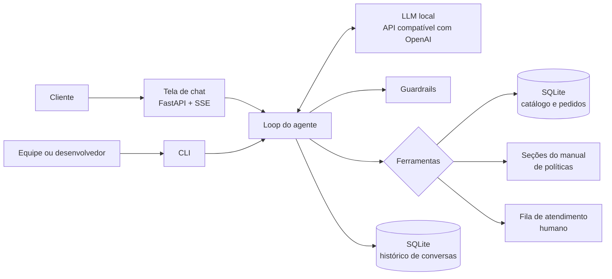

# Agente de atendimento da Empório da Música

Este repositório contém o protótipo de um agente conversacional de atendimento ao cliente para a Empório da Música, loja fictícia de instrumentos musicais sediada em Campo Grande (MS), desenvolvido como resposta ao desafio técnico para a posição de AI Engineer da Artefact. O agente conversa em português, adota a persona de um atendente com afinidade pelo rock, consulta catálogo, pedidos e políticas da loja por meio de ferramentas determinísticas e opera com modelos de linguagem executados localmente.

A especificação completa, que orientou a implementação etapa por etapa, encontra-se em [ARCHITECTURE.md](ARCHITECTURE.md).

## Sumário

1. [Visão geral da solução](#1-visão-geral-da-solução)
2. [Como executar](#2-como-executar)
3. [Decisões técnicas e justificativas](#3-decisões-técnicas-e-justificativas)
4. [Por que não grafos de conhecimento, busca híbrida e reranker](#4-por-que-não-grafos-de-conhecimento-busca-híbrida-e-reranker)
5. [Tratamento dos dados](#5-tratamento-dos-dados)
6. [Avaliação](#6-avaliação)
7. [Exemplos de interação](#7-exemplos-de-interação)
8. [Limitações conhecidas e trabalhos futuros](#8-limitações-conhecidas-e-trabalhos-futuros)
9. [Uso de assistentes de código](#9-uso-de-assistentes-de-código)

## 1. Visão geral da solução

A solução organiza-se em torno de uma divisão de responsabilidades. Ao modelo de linguagem cabe interpretar a mensagem do cliente, decidir quais informações são necessárias e redigir a resposta. Ao código Python cabe toda operação que envolva números, datas ou regras de negócio: preço promocional, desconto no PIX, opções de parcelamento, frete, prazos de troca e garantia e o estado de funcionamento da loja são calculados por funções testadas e entregues ao modelo já resolvidos. A escolha decorre de uma limitação conhecida de modelos de pequeno e médio porte, que erram aritmética e contagem de dias com frequência incompatível com um atendimento que, segundo o próprio manual da loja, não pode informar preços, estoque ou prazos sem consultar o sistema.



| Componente | Responsabilidade |
|---|---|
| ETL | Converte os CSVs em um banco SQLite com tipos corretos e campos derivados, e o manual em PDF em seções endereçáveis por tópico |
| Ferramentas | Seis funções tipadas expostas ao modelo: busca de produtos, detalhes de produto, simulação de compra, consulta de pedido, consulta de políticas e encaminhamento a um atendente |
| Loop do agente | Ciclo de function calling com limite de iterações, montagem do prompt a cada turno e validação da resposta final |
| Guardrails | Verificação de que todo valor monetário citado provém de uma ferramenta, proteção de dados pessoais e respostas seguras em caso de falha |
| Interfaces | Tela de chat servida por FastAPI e linha de comando para desenvolvimento e depuração |
| Avaliação | Conjunto de casos com asserções determinísticas, usado para escolher o modelo e detectar regressões de prompt |

## 2. Como executar

### 2.1 Requisitos

- Python 3.12 e [uv](https://docs.astral.sh/uv/).
- Um servidor de modelos compatível com a API da OpenAI. Durante o desenvolvimento foram usados o [LM Studio](https://lmstudio.ai/), com runtime Vulkan, e o [Ollama](https://ollama.com/). Qualquer provedor compatível, local ou remoto, funciona ajustando as variáveis da seção 2.4.
- Para o modelo padrão, cerca de 10 GB de memória de vídeo. Em máquinas sem GPU dedicada o projeto executa, com latência maior, usando um modelo menor ou um provedor remoto.

### 2.2 Preparação do modelo local

No LM Studio, baixe o modelo `qwen3-14b` (quantização Q4_K_M), carregue-o com contexto de 32 mil tokens e ative o servidor local na porta 1234. No Ollama, o equivalente é:

```bash
ollama pull qwen3:14b
```

Nesse caso, defina `LLM_BASE_URL=http://localhost:11434/v1` e `LLM_MODEL=qwen3:14b` no arquivo `.env`.

### 2.3 Instalação e uso

A partir da raiz do repositório clonado:

```bash
uv sync
cp .env.example .env          # no PowerShell: Copy-Item .env.example .env
uv run emporio-etl            # gera o banco e as seções do manual em data/processed/
```

Conversa pela tela de chat, disponível em http://localhost:8000:

```bash
uv run emporio-web
```

Conversa pelo terminal; a opção `--debug` exibe cada chamada de ferramenta com argumentos e resultado:

```bash
uv run emporio-chat --debug
```

Testes unitários e avaliação do agente:

```bash
uv run pytest
uv run emporio-evals --modelo qwen3-14b
```

### 2.4 Configuração

| Variável | Padrão | Descrição |
|---|---|---|
| `LLM_BASE_URL` | `http://localhost:1234/v1` | Endpoint compatível com OpenAI |
| `LLM_MODEL` | `qwen3-14b` | Identificador do modelo no servidor |
| `LLM_API_KEY` | `local` | Ignorada por servidores locais; obrigatória em provedores pagos |
| `LLM_EXTRA_BODY` | vazio | Parâmetros adicionais em JSON, usados para desligar o modo de raciocínio quando o servidor exige |
| `AGORA_REFERENCIA` | `2026-03-25T10:30:00-04:00` | Data e hora que o agente considera como "agora"; vazio usa o relógio real |

A variável `AGORA_REFERENCIA` merece nota. A base de pedidos termina em 22/03/2026, e com o relógio real todos os pedidos pendentes pareceriam parados há meses, além de todos os prazos de troca estarem vencidos. O arquivo de exemplo fixa, por isso, uma data três dias após o último pedido, a mesma usada nas avaliações e nas conversas de exemplo.

## 3. Decisões técnicas e justificativas

### 3.1 Abordagem do agente: function calling com ferramentas tipadas

O agente decide, a cada mensagem, quais de seis ferramentas chamar, e cada ferramenta tem parâmetros tipados, enumerações onde o domínio é fechado (categorias, tópicos de política, motivos de encaminhamento) e saída estruturada. Foram consideradas três alternativas. Um agente de SQL daria flexibilidade, mas exporia ao modelo a tabela de clientes, com nome, telefone e e-mail, e dependeria da correção de consultas geradas por um modelo de 14 bilhões de parâmetros. Um RAG puro sobre todos os arquivos trataria dados tabulares como texto, perdendo a exatidão de filtros de preço e de estoque. Um agente ReAct textual acrescentaria etapas de raciocínio explícito sem benefício perceptível para um domínio com poucas ferramentas e fronteiras claras. A abordagem adotada concentra as regras em código verificável e reduz a decisão do modelo ao que ele faz bem: entender a intenção e escolher a ferramenta.

### 3.2 Orquestração sem framework

O ciclo de function calling foi implementado diretamente sobre o SDK `openai`, em um único módulo. LangGraph, PydanticAI e smolagents foram avaliados e preteridos porque o fluxo tem um único agente, sem ramificações nem estados complexos, e porque modelos locais exigem ajustes finos (remoção de blocos de raciocínio, chamadas paralelas, repasse de parâmetros específicos do servidor) mais simples de controlar sem uma camada intermediária. O código resultante pode ser lido de ponta a ponta em poucos minutos, o que também favorece a avaliação.

### 3.3 Modelo e provedor

Optou-se por modelos locais, executados em uma AMD Radeon RX 9070 com 16 GB de memória de vídeo. Os candidatos foram o Qwen3-14B e o gpt-oss-20b, ambos com suporte consistente a chamadas de ferramenta, bom desempenho em português e tamanho compatível com a memória disponível com folga para 32 mil tokens de contexto. A escolha final entre eles baseou-se nos resultados do conjunto de avaliação (seção 6). No Windows, o suporte da arquitetura RDNA4 mostrou-se mais estável pelo backend Vulkan do llama.cpp, o que motivou o uso do LM Studio. Como todo o acesso ao modelo passa por uma API compatível com a da OpenAI, a troca de provedor exige apenas alterar variáveis de ambiente.

### 3.4 Arquitetura de recuperação

A recuperação de informação segue três caminhos, cada um adequado à natureza do conteúdo:

| Conteúdo | Forma de acesso | Justificativa |
|---|---|---|
| Catálogo, promoções e pedidos | Consultas SQL parametrizadas dentro das ferramentas, com correspondência aproximada de nomes (rapidfuzz) | Dados estruturados exigem filtros exatos de preço, categoria e disponibilidade |
| Políticas da loja | Ferramenta que recebe tópicos de uma enumeração e devolve as seções correspondentes do manual, preservando tabelas | O manual tem oito páginas organizadas em seções numeradas com títulos inequívocos; a própria estrutura do documento resolve a recuperação com exatidão |
| Ficha da loja (endereço, contatos, horários) e estado atual (aberta ou fechada) | Inseridos no prompt de sistema a cada turno; o estado é calculado em código | Informação curta, usada com frequência e cuja omissão causaria chamadas de ferramenta desnecessárias |

Manter as políticas atrás de uma ferramenta, em vez de incluir o manual inteiro no prompt, também torna observável, em cada resposta, a decisão do agente de consultar dados ou políticas, comportamento exigido pelo desafio.

### 3.5 Estratégia de prompt

O prompt de sistema é um arquivo versionado, preenchido a cada turno com a data e a hora correntes e o estado da loja. Sua estrutura segue a ordem identidade e persona, contexto temporal, ficha da loja, critérios de uso de cada ferramenta, regras inegociáveis, situações especiais e estilo. As regras inegociáveis derivam do próprio manual: preço, estoque e prazo apenas a partir de resultados de ferramenta; promoções sempre apresentadas com preço original, percentual e preço final; desconto do PIX nunca aplicado sobre preço promocional; dados de pedido apenas após verificação de identidade; nenhum produto, loja parceira ou desconto inventado. As descrições das ferramentas, escritas em português, complementam o prompt indicando ao modelo quando cada uma deve ser usada. A temperatura é mantida em 0,3, valor que preserva alguma naturalidade na redação sem comprometer a escolha de ferramentas.

Como salvaguarda adicional, toda resposta passa por uma verificação antes de chegar ao cliente: cada valor em reais citado precisa constar de algum resultado de ferramenta da conversa ou de mensagem do próprio cliente. Uma resposta reprovada é devolvida ao modelo uma única vez, com a lista de valores permitidos; persistindo o erro, o cliente recebe uma resposta segura que oferece atendimento humano.

### 3.6 Persona

O manual da loja descreve o tom desejado como informal, mas profissional, comparável a uma conversa com um amigo que entende de música. A persona adotada, chamada Riff, acrescenta a esse tom uma afinidade declarada pelo rock, coerente com a identidade de uma loja de instrumentos. A personalidade é regulada por limites explícitos: no máximo uma expressão característica e um emoji por mensagem, nenhuma descontração em reclamações, atrasos ou cancelamentos, e prioridade absoluta da clareza sobre o estilo.

### 3.7 Interface

A interface principal é uma tela de chat em HTML, CSS e JavaScript sem etapa de compilação, servida pelo próprio FastAPI. Durante o processamento, a tela exibe em tempo real qual consulta o agente está realizando ("consultando o catálogo", "verificando o pedido"), por meio de eventos enviados pelo servidor (SSE). Streamlit, Chainlit e Gradio foram descartados por oferecerem menos controle sobre a identidade visual, que se quis próxima à de um aplicativo de assistente. A linha de comando permanece como ferramenta de desenvolvimento, com modo de depuração que expõe cada chamada de ferramenta.

A resposta final não é transmitida token a token, porque precisa ser validada integralmente antes de exibida (seção 3.5). A tela compensa a espera com o indicador de atividade e uma animação de entrada do texto.

### 3.8 Persistência do histórico

O histórico de cada conversa é armazenado em SQLite, identificado por sessão, incluindo as mensagens de ferramenta, de modo que o agente mantém o contexto entre turnos (por exemplo, um pedido já verificado) e a tela restaura a conversa ao ser recarregada. O histórico enviado ao modelo é limitado por um orçamento de tokens, descartando-se primeiro os turnos mais antigos.

## 4. Por que não grafos de conhecimento, busca híbrida e reranker

Arquiteturas de recuperação mais elaboradas foram consideradas e deliberadamente excluídas, por dois motivos: a ausência de necessidade técnica e o prazo de dois dias.

Quanto à necessidade, cada técnica resolve um problema que este domínio não apresenta. Grafos de conhecimento justificam-se quando as respostas dependem de relações de múltiplos saltos entre entidades heterogêneas, muitas vezes extraídas de texto não estruturado. Aqui, as relações entre produto, categoria, promoção, pedido e cliente já estão explicitamente modeladas no esquema relacional fornecido, e consultas parametrizadas as percorrem com exatidão; um grafo duplicaria esse modelo sem acrescentar capacidade de resposta. A busca híbrida, que combina recuperação lexical e densa, compensa as fraquezas de cada abordagem em corpora extensos e heterogêneos, nos quais nem palavras-chave nem embeddings isoladamente garantem boa revocação. O manual da loja, porém, tem oito páginas e 28 seções e subseções com títulos inequívocos, e a recuperação por tópico sobre essa estrutura é exata e auditável. O reranker, por fim, reordena uma lista ampla de candidatos produzida por uma recuperação de alta revocação; sem centenas de trechos candidatos, não há lista a reordenar.

Quanto ao prazo, cada componente adicional consumiria tempo de implementação e de calibração, além de disputar os 16 GB de memória de vídeo com o modelo de linguagem e acrescentar latência a cada turno. Preferiu-se investir esse tempo em regras de negócio testadas, na verificação de valores monetários e em um conjunto de avaliação, que atacam diretamente os riscos mais relevantes de um agente de atendimento: informar preço errado, prometer o que a política não permite e expor dados de clientes.

A decisão não é definitiva. A incorporação de novos documentos não estruturados, como perguntas frequentes ou o histórico de atendimentos, justificaria recuperação vetorial por trechos; uma queda de revocação medida pelo conjunto de avaliação justificaria busca híbrida com reranker; e um catálogo com milhares de itens e atributos heterogêneos justificaria um mecanismo de busca dedicado.

## 5. Tratamento dos dados

A inspeção exploratória dos arquivos fornecidos revelou inconsistências que, não tratadas, levariam o agente a informar dados incorretos. Cada uma recebeu um tratamento explícito, implementado no ETL ou nas regras de domínio, coberto por testes e registrado no relatório gerado automaticamente em `docs/qualidade_dos_dados.md`.

### 5.1 Inconsistências identificadas

| ID | Inconsistência | Evidência | Tratamento |
|---|---|---|---|
| T1 | Categorias sem nenhum produto | Instrumentos de Sopro (Madeiras e Metais) e Cordas Orquestrais, embora o manual afirme comercializá-los | O agente informa que não há itens disponíveis no momento, não sugere modelos inexistentes e oferece contato com a equipe |
| T2 | Produto ativo com estoque zerado | Giannini GF-3D (id 96) | Classificado como esgotado; o agente sugere alternativas da mesma categoria, como determina o manual |
| T3 | Produto descontinuado com estoque positivo | Ibanez Bass 2X (id 136), com 13 unidades | O status de descontinuado prevalece sobre o estoque, conforme o manual, que manda informar que o produto saiu do catálogo |
| T4 | Produto "em breve" com estoque e já vendido | Kala KA-ABP-CTG (id 130), presente nos pedidos 3 e 14 | Não é oferecido para venda; os pedidos históricos permanecem válidos, interpretando-se o status como estado atual do catálogo |
| T5 | Descrição que atribui o produto a outra marca | "Music Man Bass 1X" descrito como Fender Jazz Bass; "Yamaha Bass 3X" como Ibanez; "Korg Synth 1 Pro" como Roland; uma bateria Yamaha como Pearl e um teclado Roland como Yamaha (5 produtos) | O nome é tratado como fonte canônica; descrições conflitantes são detectadas pelo ETL e excluídas da busca e das respostas |
| T6 | Promoções repetidas e majoritariamente inativas | Três produtos com duas entradas; apenas 4 das 25 promoções ativas | Apenas promoções ativas são consideradas; havendo mais de uma, vale a de maior desconto, pois promoções não são cumulativas |
| T7 | Total do pedido diferente da soma dos itens | Pedidos 3 (R$ 3.450,00 contra R$ 3.498,00) e 20 (R$ 1.400,00 contra R$ 1.488,00) | Prevalece o total registrado no pedido, que pode refletir negociação; o agente não recalcula pedidos |
| T8 | E-mail compartilhado por dois clientes | `bruno.martins@jmail.com`, clientes 11 e 43 | A consulta sem número de pedido exige e-mail e telefone em conjunto |
| T9 | Parcelamentos históricos abaixo do mínimo vigente | Pedidos 9 e 16, em 6 parcelas inferiores a R$ 80,00, e pedido 18, cancelado, em 12 parcelas de R$ 38,33 | Tratados como registro histórico; as regras vigentes aplicam-se apenas a simulações |
| T10 | Pedido enviado com previsão de entrega vencida | Pedido 8 | O agente informa o rastreio, reconhece o atraso e oferece encaminhamento à equipe |
| T11 | Contatos divergentes no manual | WhatsApp (67) 3341-4444 na ficha cadastral e (67) 3321-4500 na seção de atendimento; e-mail com e sem acento | Adotada a ficha cadastral para telefone e WhatsApp, e o e-mail sem acento; divergência registrada para validação com a loja; o texto servido ao agente já traz a correção |
| T12 | Regras de parcelamento contraditórias | A tabela de formas de pagamento fixa parcela mínima de R$ 100,00; a seção seguinte escalona o mínimo pelo número de parcelas | Prevalece a regra escalonada, mais específica; a tabela de pagamentos servida ao agente remete a ela |
| T13 | Base temporalmente defasada | Último pedido em 22/03/2026 | Data de referência configurável (seção 2.4) |

### 5.2 Suposições adotadas

Diante de lacunas nos dados e no manual, adotaram-se as interpretações abaixo, todas isoladas em pontos únicos do código para facilitar revisão.

| ID | Suposição | Fundamento |
|---|---|---|
| S1 | Todos os pedidos da base são compras online, sujeitas ao direito de arrependimento | Todos possuem entrega e código de rastreio; o canal de venda não é registrado |
| S2 | A data de recebimento é a data prevista de entrega | Não há registro da entrega efetiva |
| S3 | Arrependimento e troca por preferência contam do recebimento; troca por defeito conta da compra; garantia legal conta do recebimento | Texto literal do manual; para a troca por preferência, que não define o marco, adotou-se o mesmo do arrependimento |
| S4 | A região metropolitana de Campo Grande corresponde ao município | O manual não enumera municípios |
| S5 | Pedidos de exatamente R$ 500,00 têm frete grátis | O manual define "acima de" e "abaixo de" R$ 500,00, sem tratar a igualdade; a ambiguidade foi resolvida em favor do cliente |
| S6 | "Contrabaixos", no contexto de frete especial, refere-se aos acústicos; baterias acústicas exigem cotação | Seção de frete do manual, lida em conjunto com as categorias do catálogo |
| S7 | Em até três parcelas, o valor mínimo de cada uma é R$ 50,00 | Leitura da regra de parcelamento; sem efeito prático, pois o item mais barato custa R$ 159,90 |
| S8 | Feriados não são considerados no cálculo do horário de funcionamento | Não há calendário de feriados disponível |
| S9 | Não há lojas parceiras cadastradas, e o agente não cita nomes | O manual recomenda sugerir parceiras apenas "quando possível" |
| S10 | Filtros de preço consideram o preço final, com promoção | É o valor efetivamente pago pelo cliente |

### 5.3 Proteção de dados pessoais

O manual declara conformidade com a LGPD, e o agente respeita esse compromisso na camada de ferramentas, independentemente do comportamento do modelo. Dados de pedido só são revelados após verificação por número do pedido acompanhado de e-mail ou telefone do titular. Falhas de verificação produzem sempre a mesma mensagem, de modo a não revelar se um pedido existe, e são limitadas a três tentativas por sessão. Mesmo após a verificação, o modelo recebe apenas o primeiro nome do cliente; e-mail e telefone completos nunca são incluídos no contexto.

## 6. Avaliação

O comportamento do agente é medido por um conjunto de cerca de trinta casos em `evals/cases.yaml`, distribuídos entre catálogo, pagamento, políticas, pedidos e escopo. Cada caso define as mensagens do cliente, as ferramentas que devem ser chamadas e asserções sobre o texto da resposta (termos obrigatórios e proibidos, comparados sem distinção de maiúsculas e acentos). Entre os casos estão as armadilhas descritas na seção 5, como o produto descontinuado com estoque, a descrição de marca trocada e a consulta de pedido com verificação incorreta. O executor registra a taxa de acerto no roteamento de ferramentas, a taxa de asserções aprovadas, as intervenções do verificador de valores monetários e a latência por turno, gravando um relatório por modelo em `evals/reports/`.

O conjunto tem duas funções: fundamentar a escolha do modelo em desempenho medido e servir de teste de regressão a cada alteração do prompt ou das descrições das ferramentas.

## 7. Exemplos de interação

O diretório [examples/](examples/) reúne conversas geradas por script a partir de execuções reais do agente, com a data de referência fixada em 25/03/2026 às 10h30. Cada arquivo registra o modelo utilizado e as ferramentas chamadas em cada turno. Os cenários cobrem consulta ao catálogo com faixa de preço, informações gerais da loja, preço com promoção e parcelamento, pedido de devolução com verificação de identidade e aplicação dos prazos do manual, e perguntas fora do escopo, incluindo acessórios e tentativa de manipulação.

## 8. Limitações conhecidas e trabalhos futuros

As limitações abaixo decorrem do prazo, das lacunas dos dados ou de escolhas conscientes de escopo.

| Limitação | Situação atual | Encaminhamento com mais tempo |
|---|---|---|
| Prazos de troca e garantia | Dependem da data de recebimento, aproximada pela previsão de entrega (S2) | Registrar a entrega efetiva no sistema de pedidos |
| Feriados | O cálculo de loja aberta os ignora (S8) | Calendário nacional, de Mato Grosso do Sul e de Campo Grande pela biblioteca `holidays` |
| Frete para outras cidades | O agente informa modalidades e prazos, mas não valores | Integração com tabela de fretes por CEP |
| Encaminhamento a humanos | Gravado em arquivo local | Integração com ferramenta de tickets ou com o WhatsApp da loja |
| Verificação de identidade | Número do pedido com e-mail ou telefone, verificação fraca aceitável para um protótipo | Número de WhatsApp autenticado ou código de uso único |
| Afirmações qualitativas | O verificador automático cobre valores monetários; afirmações sobre disponibilidade dependem do prompt e da avaliação | Verificação estruturada da resposta contra os resultados das ferramentas |
| Viés da avaliação | Casos escritos pelo próprio autor, que conhecia as armadilhas dos dados | Casos coletados de atendimentos reais e avaliação de tom por um modelo juiz |
| Observabilidade | Sem rastreamento estruturado das execuções | Traces com OpenTelemetry ou Langfuse, com latência e falhas por ferramenta |
| Recuperação | Adequada ao corpus atual | Critérios de evolução descritos na seção 4 |

## 9. Uso de assistentes de código

O projeto foi desenvolvido com o Claude Code, no aplicativo desktop, segundo a prática de desenvolvimento orientado a especificação (spec-driven development), em duas fases com configurações distintas.

Na fase de concepção, utilizou-se o modelo Claude Opus 5.5 com esforço de raciocínio extra alto. Nessa fase, o assistente leu o enunciado, o manual e os dados, executou a inspeção exploratória que revelou as inconsistências da seção 5 e, a partir da discussão das alternativas com o autor, redigiu a especificação em [ARCHITECTURE.md](ARCHITECTURE.md). A especificação descreve decisões, regras de negócio com exemplos numéricos, contratos das ferramentas e nove etapas de implementação, cada uma com tarefas, critérios de aceite e mensagem de commit. Na mesma fase foi criado um painel de acompanhamento, publicado como Artifact do Claude, que exibe cada etapa com o trecho da especificação que a define, suas tarefas e seu estado. O painel é atualizado tanto manualmente quanto pelas próprias sessões do assistente, e o script `scripts/painel_payload.py` mantém o conteúdo do painel sincronizado com o arquivo de especificação.

Na fase de implementação, cada etapa foi executada pelo modelo Claude Sonnet 5.5 com esforço alto, tendo a especificação como contrato e os critérios de aceite como condição de conclusão. A divisão reservou o modelo de maior capacidade para o momento em que erros custam mais caro, a definição da arquitetura e a interpretação das regras, e empregou um modelo mais rápido na execução de tarefas já delimitadas.

As decisões de produto couberam ao autor, entre elas a persona roqueira, o formato da interface e a exclusão de grafos de conhecimento, busca híbrida e reranker. Coube ao assistente propor alternativas, apontar riscos e executar. A segurança do repositório foi verificada com a skill de auditoria `github-security-audit` antes da criação do repositório público, antes do primeiro envio de código e na entrega final.
